# KẾ HOẠCH TỔNG THỂ: KHẮC PHỤC TRIỆT ĐỂ BUGS PC & MOBILE, HỘP QUÀ BÍ MẬT TUẦN TỰ & NÂNG CẤP ÂM NHẠC

> **Dự án**: Khu Vườn Di Sản Thơ Ca Việt Nam (Dieu Bi Mat Epic).  
> **Mục tiêu**: 
> 1. Xử lý triệt để toàn bộ 100% bugs giao diện và mất khả năng tương tác trên Mobile & PC (phân tích từ 5 hình ảnh/screenshot thực tế trong thư mục `test_thực_tế_trên_iphone/`).
> 2. Khắc phục lỗi kẹt tương tác Game-Breaking ở Stage 2 (Vươn Cành) do CSS ẩn nhầm HUD khí hậu tự nhiên.
> 3. Tái cấu trúc chuông hoa Simon Melody và thiên văn, chống va chạm hoàn toàn với Linh vật Mascot và Đàn Mộc Cầm.
> 4. Chuyển đổi và nén tối ưu 2 video quà tặng (từ ~2GB xuống siêu nhẹ ~25-30MB) với thuật toán phát mượt mà không giật lag.
> 5. Xóa bỏ hoàn toàn link Google Drive, thay thế bằng 2 Hộp Quà Bí Mật Di Sản Sơn Mài tuần tự (Hộp 2 mở khóa sau khi xem hết Video 1).
> 6. Nâng cấp cơ chế âm nhạc BGM: Random 70% `nhac_2` / 30% `nhac_1`, tự động chuyển bài tiếp theo khi nghe hết.
> 7. Sửa lỗi cú pháp do kaomoji `(❁´◡`❁)` trong `content.js`.
> **Cam kết**: 100% Zero PC Regression, Touch Target $\ge 48\text{px}$, 100% Pure Static Web (Offline & GitHub Pages).

---

## I. BẢNG PHÂN TÍCH NGUYÊN NHÂN GỐC RỄ TỪ ẢNH THỰC TẾ & MÃ NGUỒN

| STT | Ảnh Thực Tế / Hiện Tượng | Hiện Tượng Gặp Phải | Nguyên Nhân Gốc Rễ Trong Mã Nguồn | Giải Pháp Kỹ Thuật Triệt Để |
| :--- | :--- | :--- | :--- | :--- |
| **1** | `lỗi_mất_khả_năng_tương_tác_ở phase 2_trên PC_và mobile.png` | **Cây non vươn cành nhưng mất hoàn toàn mọi nút tương tác trên cả PC và Mobile.** Người dùng bấm màn hình chỉ ra thông báo "gõ đúp hạt sương" nhưng không tiến triển được. | Trong [css/layout.css](file:///c:/Users/kishikuun/Documents/dieu-bi-mat-epic/css/layout.css#L298), CSS quy định `body.stage-3-active #living-atmosphere-hud { display: none !important; opacity: 0 !important; }`. Khi Stage 2 bắt đầu, code gán `stage-3-active` cho body, khiến Vệt Nắng Vàng `#atmosphere-sun-shifter` (thao tác bắt buộc để sưởi ấm mầm cây) bị ẩn vĩnh viễn! Người chơi tap màn hình gọi sương (`isWatered`) nhưng Stage 2 lại yêu cầu `isFertilized`, dẫn đến kẹt 100%. | Gỡ bỏ `display: none !important` đối với `#living-atmosphere-hud` ở Stage 2; cho phép Vệt Nắng Ban Mai hiển thị lộng lẫy để kéo sưởi ấm mầm cây; đồng thời tại [js/atmosphere-shifter.js](file:///c:/Users/kishikuun/Documents/dieu-bi-mat-epic/js/atmosphere-shifter.js) bổ sung logic: ở Stage 2, double-tap hoặc xoa đất kích hoạt hiệu ứng sưởi ấm rễ mầm (`isFertilized = true`) giúp tiến trình không bao giờ bị nghẽn. |
| **2** | `1793111794971_...80fb6dda965d52355fe304b6f9876a5a.jpg` (iPhone Landscape) | **Nốt chuông hoa Simon bị đè và che khuất 2 bên cánh gà**: Nốt trái bị Linh vật Mascot & thanh âm thanh đè lên; Nốt phải bị Đàn Mộc Cầm (330px) và icon nốt nhạc che lấp; Bảng `#garden-ui` quá to che mầm cây. | - Đàn Mộc Cầm trong `@media (max-height: 540px) and (orientation: landscape)` có `--harp-w: 330px` (chiếm quá nửa chiều cao và góc phải màn hình), đè lên slot nốt 2 & 3.<br>- Linh vật Mascot ở `left: 12px; bottom: 56px` đè lên slot nốt 0 & 1.<br>- Bảng `#garden-ui` cao ~170px trên màn hình chỉ cao 375px. | - Thu gọn Đàn Mộc Cầm trong mobile landscape xuống `--harp-w: 220px` hoặc tạm ẩn/làm mờ khi Minigame Simon đang chạy.<br>- Điều chỉnh tọa độ nốt Simon dạt về vùng an toàn trống trải.<br>- Tinh gọn `#garden-ui` landscape cao $\le 52\text{px}$. |
| **3** | `1793111795007_...f5fbec596972e6c226b3e2a70d90faf6.jpg` (iPhone Portrait) | **Không thấy bất kỳ nốt chuông hoa nào trên màn hình dọc**, chỉ có thân mầm cây và bảng thông báo ở trên. Sau 40s mới hiện nút bỏ qua. | `#wrap` bị co nhỏ bằng `scale(0.34)` và neo ở `top: 48%`. Khi đó các nốt Simon đặt theo `%` của `#wrap` bị thu nhỏ li ti (~23px) và bị chìm dưới layer thảm cỏ `#co-hoa` (`z-index: 12`) hoặc lệch khỏi tầm mắt. | Đưa nốt Simon trên mobile portrait ra tầng viewport độc lập hoặc điều chỉnh tọa độ và kích thước nốt Simon đảm bảo luôn $\ge 52\text{px}$, hiển thị rõ ràng trên nền trời 2 bên mầm cây, không bị `#co-hoa` hay `#garden-ui` che khuất. |
| **4** | `1793111795027_...960f814f76562ca73b35dc4f7079e1a8.jpg` | **Ảnh Polaroid chụp ra chỉ có thân cây trơ trụi hình que nhọn**, không có tán hoa trái tim hay màu sắc rực rỡ. | Do Stage 2 bị kẹt, cây chưa bao giờ hoàn thành nở hoa Stage 4, nên `renderGardenPolaroidToCanvas` rơi vào fallback vẽ snapshot mầm cây Stage 1 (`currentGardenSnapshotUrl`). | Khắc phục xong Stage 2 giúp cây nở hoa hoàn tất; đảm bảo `window.bloomedTreeImage` luôn được nạp đầy đủ ảnh cây hoa nở rộ; nếu chụp ở Stage 1-3 thì khung ảnh hiển thị nhãn "Mầm xanh đang lớn" trang nhã. |
| **5** | `1793111795046_...91ee10030be1c40d43061b4d5bc6dd28.jpg` | **Hộp thoại Góc nhìn toàn cảnh (Rotate Overlay) hiện nút Bypass "Tiếp tục ở góc nhìn hiện tại"**: Khi bấm tiếp tục ở chế độ dọc thì các minigame cần thích ứng hoàn hảo. | Người dùng bấm nút Bypass thì ở lại chế độ dọc, nhưng các thành phần minigame trước đây chỉ tối ưu cho màn hình ngang landscape. | Tinh chỉnh tính tương thích 2 chiều: dù người dùng xoay ngang hay chọn tiếp tục ở màn hình dọc, mọi nút bấm, minigame chuông hoa, nối sao hoàng đạo đều tự động căn chỉnh hoàn mỹ. |
| **6** | `content.js` Syntax Error | **File `content.js` bị lỗi cú pháp `SyntaxError: Invalid or unexpected token` do ký tự `(❁´◡`❁)`.** | Ký tự dấu huyền `` ` `` trong kaomoji làm đóng sớm template literal `` `...` ``. | Đã escape thành `\`\`` (đã sửa và kiểm tra `node -c js/content.js` passed). |
| **7** | Video Quá Nặng (~2GB) & Link Drive Cũ | **File `video/vid_1.mp4` nặng 1.8GB (4K 120fps HEVC), không thể xem trên web hay deploy GitHub Pages.** Cần thay link Drive bằng 2 Hộp Quà tuần tự. | Video gốc quay ở cấu hình quay phim cực đại 4K 120fps 45.7Mbps. Link Drive bên ngoài làm đứt gãy trải nghiệm người dùng trong ứng dụng. | Nén video bằng `ffmpeg` sang H.264 720p/480p với cờ `+faststart` (dung lượng giảm ~98% xuống ~25-30MB, phát ngay không lag); thay thế link Drive bằng 2 Hộp Quà Di Sản Sơn Mài tương tác, Hộp 2 mở sau khi xem xong Video 1. |
| **8** | Cơ Chế Âm Nhạc BGM | **Hiện tại BGM chọn 50/50. Cần đổi thành 70% `nhac_2` và 30% `nhac_1`, hết bài tự phát tiếp bài kia.** | Code cũ dùng `Math.floor(Math.random() * 2)`. | Cập nhật công thức xác suất `Math.random() < 0.7 ? 1 : 0` (70% nhac_2 / 30% nhac_1); duy trì sự kiện `ended` để tự động đổi bài liền mạch. |

---

## II. LỘ TRÌNH TRIỂN KHAI CHI TIẾT THEO TỪNG PHASE

```mermaid
flowchart TD
    subgraph PHASE_7["Phase 7: Sửa Triệt Để Lỗi Kẹt Tương Tác Stage 2 Trên PC & Mobile"]
        P7_A["Gỡ bỏ display:none của HUD khí hậu ở Stage 2 trong CSS"]
        P7_B["Hiển thị Vệt Nắng Ban Mai sưởi ấm mầm cây"]
        P7_C["Bổ sung tương tác double-tap & vuốt sưởi ấm rễ cây"]
        P7_D["Thêm cơ chế tự động cứu nguy sau 25s"]
    end

    subgraph PHASE_8["Phase 8: Tái Cấu Trúc Toàn Diện Chuông Hoa Simon & Chống Va Chạm"]
        P8_A["Thu nhỏ Đàn Mộc Cầm trong mobile landscape & ẩn tạm khi chơi chuông"]
        P8_B["Cách ly nốt Simon khỏi Mascot và thanh âm thanh bên trái"]
        P8_C["Tối ưu nốt Simon trên Mobile Portrait: Kích thước >= 52px, dễ bấm"]
        P8_D["Thu gọn bảng hướng dẫn garden-ui landscape <= 52px"]
    end

    subgraph PHASE_9["Phase 9: Nén Video Siêu Nhẹ & Thuật Toán Trình Chiếu Zero-Lag"]
        P9_A["Nén vid_1 (1.8GB) -> 720p 30fps H.264 +faststart (~30MB)"]
        P9_B["Nén vid_2 (70MB) -> 480p 30fps H.264 +faststart (~26MB)"]
        P9_C["Xây dựng Video Player Lightbox với auto BGM ducking/pause"]
        P9_D["Cấu hình .gitignore bảo vệ repo khỏi file video gốc khổng lồ"]
    end

    subgraph PHASE_10["Phase 10: Hệ Thống 2 Hộp Quà Bí Mật Tuần Tự (Interactive Dual Gift Boxes)"]
        P10_A["Xóa bỏ link Drive trong content.js, thay bằng UI 2 Hộp Quà"]
        P10_B["Thiết kế Hộp Quà Sơn Mài Dó Paper với nơ vàng & hiệu ứng bung quà"]
        P10_C["Khóa Hộp Quà 2 cho đến khi xem hết Video 1"]
        P10_D["Lễ mở khóa Hộp Quà 2 với hiệu ứng âm thanh & pháo hoa chúc mừng"]
    end

    subgraph PHASE_11["Phase 11: Nâng Cấp Hệ Thống BGM (Random 70/30 & Phát Nối Bài)"]
        P11_A["Cập nhật xác suất chọn nhạc ban đầu: 70% nhac_2, 30% nhac_1"]
        P11_B["Tự động chuyển bài khi kết thúc (Loop Cycle qua sự kiện ended)"]
        P11_C["Đồng bộ mascot thông báo tên bài hát tiếp theo"]
    end

    subgraph PHASE_12["Phase 12: Đảm Bảo Ảnh Polaroid Trọn Vẹn Cây Hoa Nở Rộ & Kiểm Thử Toàn Diện"]
        P12_A["Bảo đảm chụp ảnh Polaroid ở Stage 4 bắt trọn cây hoa trái tim"]
        P12_B["Viết bộ test tự động Node.js kiểm tra toàn diện"]
        P12_C["Kiểm thử Zero PC Regression & tương thích di động đa trình duyệt"]
        P12_D["Quy trình Git 3-Dev Auto-Sync: Âm thầm, tiết kiệm tokens"]
    end

    PHASE_7 --> PHASE_8 --> PHASE_9 --> PHASE_10 --> PHASE_11 --> PHASE_12
```



---

### GIAI ĐOẠN 7: SỬA TRIỆT ĐỂ LỖI KẸT TƯƠNG TÁC STAGE 2 (VƯƠN CÀNH) TRÊN CẢ PC VÀ MOBILE
*Mục tiêu*: Giải quyết dứt điểm lỗi kẹt cây trơ cành không có nút bấm như trong ảnh chụp `lỗi_mất_khả_năng_tương_tác_ở phase 2_trên PC_và mobile.png`.

#### Task 7.1: Gỡ bỏ quy tắc CSS ẩn `#living-atmosphere-hud` ở Stage 2
- **Mô tả**:
  - Tại [css/layout.css](file:///c:/Users/kishikuun/Documents/dieu-bi-mat-epic/css/layout.css#L298) và [css/components.css](file:///c:/Users/kishikuun/Documents/dieu-bi-mat-epic/css/components.css), xóa bỏ bộ chọn `body.stage-3-active #living-atmosphere-hud` khỏi danh sách `display: none !important`.
  - Ở Stage 2 (tương ứng với class `stage-3-active` của body), `#living-atmosphere-hud` phải hiển thị với `display: flex; opacity: 1; pointer-events: auto;`.
- **Tiêu chuẩn chấp thuận**: Khi cây chuyển sang Stage 2 (Vươn Cành), token Vệt Nắng Ban Mai `#atmosphere-sun-shifter` xuất hiện lấp lánh trên bầu trời, người dùng có thể chạm hoặc kéo để sưởi ấm mầm cây.
- **Files**: `css/layout.css`, `css/components.css`.

#### Task 7.2: Khắc phục logic Double-Tap và Chạm Rễ Cây trong `atmosphere-shifter.js`
- **Mô tả**:
  - Tại [js/atmosphere-shifter.js](file:///c:/Users/kishikuun/Documents/dieu-bi-mat-epic/js/atmosphere-shifter.js#L275), trong hàm xử lý chạm mặt đất/gõ đúp:
    - Kiểm tra `window.gardenState.currentStage`:
      - Nếu `currentStage === 0 || currentStage === 1`: gọi tưới sương mát (`isWatered = true`, thông báo tưới nước).
      - Nếu `currentStage === 2`: gọi sưởi ấm rễ mầm (`isFertilized = true`, kích hoạt `triggerRootThermalWarmth()`, thông báo sưởi ấm mầm non).
    - Gọi `window.checkGrowth()` để kích hoạt chuyển sang Minigame Chòm Sao Stage 3.
- **Tiêu chuẩn chấp thuận**: Người dùng gõ đúp hoặc kéo nắng đều tiến hành phát triển cây thành công, không bao giờ bị rơi vào trạng thái "tưới nước vô tác dụng".
- **Files**: `js/atmosphere-shifter.js`, `js/garden-stages.js`.

#### Task 7.3: Bổ sung Graceful Auto-Fallback cho Stage 2
- **Mô tả**:
  - Nếu sau 25 giây ở Stage 2 người dùng chưa thực hiện thao tác kéo nắng hoặc chạm đất, hệ thống tự động kích hoạt làn gió nắng ấm thoảng qua (`triggerRootThermalWarmth()`), cây tự động hấp thu năng lượng và tiến lên Stage 3 (kết nối chòm sao).
- **Tiêu chuẩn chấp thuận**: Không một người dùng nào có thể bị kẹt lại Stage 2 dù không biết cách tương tác.
- **Files**: `js/garden-stages.js`.

---

### GIAI ĐOẠN 8: TÁI CẤU TRÚC TOÀN DIỆN CHUÔNG HOA (SIMON MELODY) & CHỐNG VA CHẠM
*Mục tiêu*: Khắc phục triệt để hiện tượng nốt chuông hoa bị Mascot, Đàn Mộc Cầm hoặc khung thông báo che khuất trên mobile landscape (ảnh 1) và mất nốt trên mobile portrait (ảnh 2).

#### Task 8.1: Chống va chạm phía Trái trên Mobile Landscape (Mascot & Volume Dock)
- **Mô tả**:
  - Trong `@media (max-height: 540px) and (orientation: landscape)`:
    - Tọa độ nốt Simon 0: `left: 18%, top: 44%`.
    - Tọa độ nốt Simon 1: `left: 28%, top: 66%`.
    - Khoảng cách giữa mép phải Mascot (`left: 12px`, rộng 68px) đến tâm nốt Simon gần nhất luôn $\ge 65\text{px}$.
    - Khử hoàn toàn hiện tượng Mascot avatar hoặc bóng thoại đè lên nút chuông hoa.
- **Tiêu chuẩn chấp thuận**: Nốt chuông hoa số 0 và 1 nằm hoàn toàn ở vùng trời quang đãng bên trái mầm cây, cách biệt với Mascot và thanh nhạc.
- **Files**: `js/garden-minigames.js`, `css/components.css`.

#### Task 8.2: Chống va chạm phía Phải trên Mobile Landscape (Đàn Mộc Cầm vs Chuông Hoa)
- **Mô tả**:
  - Tại [css/components.css](file:///c:/Users/kishikuun/Documents/dieu-bi-mat-epic/css/components.css):
    - Khi `body.stage-2-active` (đang chơi chuông hoa), áp dụng quy tắc làm mờ hoặc thu gọn Đàn Mộc Cầm:
      ```css
      body.stage-2-active .plant-harp-strings-wrap {
        opacity: 0.15 !important;
        pointer-events: none !important;
      }
      ```
    - Trong mobile landscape bình thường, tinh chỉnh kích thước Đàn Mộc Cầm từ `--harp-w: 330px` về `--harp-w: 220px`, chiều cao cân xứng, không lấn át nửa phải màn hình.
    - Tọa độ nốt Simon 2: `left: 72%, top: 66%`.
    - Tọa độ nốt Simon 3: `left: 82%, top: 44%`.
- **Tiêu chuẩn chấp thuận**: Nốt chuông hoa số 2 và 3 hiển thị tròn trịa, sáng rõ, người dùng chạm bằng ngón cái phải cực kỳ thoải mái và chính xác.
- **Files**: `css/components.css`, `js/garden-minigames.js`.

#### Task 8.3: Tối ưu hiển thị Chuông Hoa trên Mobile Portrait & Chế độ Bypass
- **Mô tả**:
  - Khi người dùng ở màn hình dọc (hoặc chọn "Tiếp tục ở góc nhìn hiện tại"):
    - 4 nốt Simon được định vị ở 2 bên thân cây non:
      - Nốt 0: `left: 16%, top: 52%`, Nốt 1: `left: 22%, top: 68%`.
      - Nốt 2: `left: 78%, top: 68%`, Nốt 3: `left: 84%, top: 52%`.
    - Tăng kích thước nút chạm đạt chuẩn Apple HIG: `width: 80px; height: 80px; font-size: 32px;` với vùng đệm cảm ứng `::after` mở rộng ra thêm `16px`.
    - Nâng `z-index: 2600` cao hơn lớp cỏ `#co-hoa` (`z-index: 12`) và khung container.
- **Tiêu chuẩn chấp thuận**: Bốn nốt chuông hoa hiện rõ rệt trên màn hình iPhone dọc, âm vang du dương khi chạm vào, hiệu ứng phát sáng đồng bộ.
- **Files**: `js/garden-minigames.js`, `css/components.css`.

#### Task 8.4: Tinh gọn bảng hướng dẫn `#garden-ui`
- **Mô tả**:
  - Giới hạn chiều cao `#garden-ui` khi `body.stage-2-active` trên landscape $\le 52\text{px}$, padding $4\text{px} \times 12\text{px}$, đặt nút "Nghe lại chuông" và "Gió thoảng hoa nở" (skip) thành hàng ngang nhỏ gọn.
- **Tiêu chuẩn chấp thuận**: Giải phóng 100% tầm nhìn cho mầm cây vươn cành ở giữa màn hình.
- **Files**: `css/layout.css`, `css/components.css`.

#### Task 8.5: Đại Tu Toàn Diện Đàn Mộc Cầm Trên Mobile (Landscape & Portrait)
- **Mô tả**:
  - Khắc phục triệt để lỗi Đàn Mộc Cầm biến mất hoặc teo tóp trên mobile:
    1. **Bản chất kỹ thuật (Root Cause)**:
       - Trong DOM, `#plant-harp-strings-wrap` nằm bên trong `<div id="wrap">`. Theo chuẩn CSS Transforms, bất kỳ phần tử nào có `transform` (như `#wrap` bị scale xuống 0.34 ở portrait) sẽ trở thành Containing Block cho mọi phần tử con bên trong kể cả `position: fixed`! Do đó đàn bị teo nhỏ 3 lần (~45px) và bị dịch chuyển sai lệch hoàn toàn so với viewport.
       - Quy tắc CSS `body:not(.stage-3-active):not(.stage-4-active) .plant-harp-strings-wrap { display: none !important; }` cưỡng ép ẩn đàn ở Stage 0, 1, 2 trên mobile portrait khiến người dùng tưởng đàn bị mất tích hoàn toàn.
       - Trong `js/botanical-harp.js`, bán kính chạm `reach` chỉ là 14px (quá nhỏ cho ngón tay trên màn hình cảm ứng điện thoại, tiêu chuẩn WCAG là $\ge 44-48\text{px}$).
    2. **Giải pháp kiến trúc**:
       - Chuyển container `#plant-harp-strings-wrap` trong [index.html](file:///c:/Users/kishikuun/Documents/dieu-bi-mat-epic/index.html) ra khỏi `#wrap`, đặt trực tiếp dưới `#main-container` (cùng cấp với Mascot và Living Atmosphere HUD). Nhờ đó, đàn độc lập với ma trận biến hình của `#wrap`.
       - Xóa bỏ triệt để quy tắc `body:not(.stage-3-active):not(.stage-4-active) .plant-harp-strings-wrap { display: none !important; }`. Đàn hiển thị nhẹ nhàng, tinh tế và mờ nhẹ (`opacity: 0.15; pointer-events: none`) trong lúc chơi minigame Chuông Hoa để tránh phân tâm.
       - Trên Mobile Portrait: đặt kích thước `--harp-w: 160px`, neo góc phải dưới thảm cỏ với vùng chạm ngón tay thoải mái.
       - Trên Mobile Landscape: đặt kích thước `--harp-w: 220px` (vừa vặn, không quá to 330px gây đè chuông hoa, không quá nhỏ).
       - Trong [js/botanical-harp.js](file:///c:/Users/kishikuun/Documents/dieu-bi-mat-epic/js/botanical-harp.js): tăng bán kính dung sai chạm dây đàn `reach` từ 14px lên 26px để vuốt chạm bằng ngón tay luôn chuẩn xác 100%.
- **Tiêu chuẩn chấp thuận**: Đàn Mộc Cầm luôn hiện diện trang nhã ở cả 2 hướng màn hình dọc và ngang, gảy dây hoặc vuốt glissando phát âm thanh pha lê trong trẻo mượt mà, không bao giờ bị mất tích hay teo nhỏ.
- **Files**: `index.html`, `css/components.css`, `js/botanical-harp.js`.

---

### GIAI ĐOẠN 9: NÉN VIDEO SIÊU NHẸ & THUẬT TOÁN TRÌNH CHIẾU ZERO-LAG
*Mục tiêu*: Chuyển đổi 2 video nặng sang định dạng nén tối ưu, tải nhanh tức thì, không bị giật lag trên GitHub Pages và mobile.

#### Task 9.1: Hoàn tất chuyển đổi nén Video qua `ffmpeg` (ĐÃ HOÀN TẤT)
- **Mô tả**:
  - `vid_2.mp4` (70MB) $\rightarrow$ đã nén thành `video/vid_2_opt.mp4` (27.1MB, 640x480 30fps H.264 `yuv420p` `+faststart`, duration 334.1s).
  - `vid_1.mp4` (1.8GB 4K 120fps HEVC) $\rightarrow$ đã nén thành `video/vid_1_opt.mp4` (44.9MB, 720p 30fps H.264 `yuv420p` `+faststart`, duration 315.4s, giảm 97.5% dung lượng).
  - Cả 2 video đều đã được kiểm tra bằng `ffprobe` đảm bảo stream H.264 8-bit `yuv420p` tương thích 100% với iOS Safari, Chrome Mobile và Desktop.
  - Cập nhật `.gitignore` để loại trừ `video/vid_1.mp4` và `video/vid_2.mp4`, bảo toàn dung lượng repository Git.
- **Tiêu chuẩn chấp thuận**: Cả 2 video đều dưới 50MB, tuân thủ nghiêm ngặt chuẩn GitHub Pages, nạp khung hình đầu tiên trong $\le 200\text{ms}$.
- **Files**: `video/vid_1_opt.mp4`, `video/vid_2_opt.mp4`, `.gitignore`.

#### Task 9.2: Thuật toán trình chiếu Video tối ưu (Zero-Lag Lightbox Player)
- **Mô tả**:
  - Xây dựng component Lightbox Video Di Sản (`#gift-video-modal`):
    - Cấu hình thẻ video: `playsinline`, `webkit-playsinline`, `preload="metadata"`, `controls`.
    - Khi video bắt đầu phát (`play` event): Tự động giảm dần âm lượng nhạc nền BGM về 0 và pause nhạc nền để âm thanh video trong trẻo, không bị lẫn lộn.
    - Khi video kết thúc (`ended` event) hoặc khi người dùng đóng modal: Tự động khôi phục nhạc nền BGM êm dịu trở lại.
- **Tiêu chuẩn chấp thuận**: Trình chiếu video mượt mà 60fps trên iPhone Safari và Chrome Android, âm thanh BGM chuyển đổi tinh tế.
- **Files**: `index.html`, `css/components.css`, `js/audio-vfx.js`, `js/secret-letter.js`.

---

### GIAI ĐOẠN 10: HỆ THỐNG 2 HỘP QUÀ BÍ MẬT TUẦN TỰ (INTERACTIVE DUAL GIFT BOXES)
*Mục tiêu*: Thay thế hoàn toàn link Google Drive bằng 2 Hộp Quà Di Sản Sơn Mài tương tác, Hộp 2 mở khóa sau khi xem xong Video 1.

#### Task 10.1: Xóa bỏ đường dẫn Drive trong `content.js` & Thay thế cấu trúc dữ liệu quà tặng
- **Mô tả**:
  - Tại [js/content.js](file:///c:/Users/kishikuun/Documents/dieu-bi-mat-epic/js/content.js#L10), xóa dòng `[Mở món quà bí mật và ấm áp dành riêng cho bạn tại đây nhé! 🎁](https://drive.google.com/...)`.
  - Thay bằng khối chỉ dẫn thi vị và khai báo thông tin 2 món quà:
    - Món quà 1: "Kỷ Niệm Rực Rỡ (Hộp Quà Sơn Mài Đỏ Thắm)" -> Video 1.
    - Món quà 2: "Điều Kỳ Diệu Tiếp Nối (Hộp Quà Hoàng Kim Khóa Son)" -> Video 2 (Khóa cho đến khi hoàn thành xem video 1).
- **Tiêu chuẩn chấp thuận**: Không còn bất kỳ dấu vết nào của đường link Google Drive trong toàn bộ dự án.
- **Files**: `js/content.js`.

#### Task 10.2: Thiết kế giao diện 2 Hộp Quà Di Sản (Lacquer & Gold Gift Boxes)
- **Mô tả**:
  - Tạo giao diện 2 Hộp Quà đặt trang nhã cuối bức thư lá Dó (`#secret-gift-boxes-deck`):
    - **Hộp Quà 1 (Món Quà Thứ Nhất)**: Vỏ sơn mài đỏ chu sa, nơ lụa vàng kim đung đưa, particle lấp lánh, trạng thái Sẵn Sàng Mở.
    - **Hộp Quà 2 (Món Quà Thứ Hai)**: Vỏ gỗ hoàng đàn thếp vàng, có biểu tượng Ổ Khóa Hoàng Gia 🔒 e ấp, kèm dòng chữ nhỏ: *"Xem hết món quà 1 để mở khóa nhé! ✨"*.
- **Tiêu chuẩn chấp thuận**: Giao diện đậm chất Quiet Luxury Atelier, responsive hoàn hảo trên mobile portrait, mobile landscape và PC.
- **Files**: `css/components.css`, `index.html`.

#### Task 10.3: Cơ chế Khóa & Mở Khóa Tuần Tự (Sequential Unlocking Engine)
- **Mô tả**:
  - Tại [js/secret-letter.js](file:///c:/Users/kishikuun/Documents/dieu-bi-mat-epic/js/secret-letter.js):
    - Khi bấm Hộp Quà 1: Mở lightbox xem `vid_1_opt.mp4`.
    - Lắng nghe sự kiện `timeupdate` và `ended` của thẻ video:
      - Khi `currentTime >= duration * 0.95` hoặc khi video kích hoạt sự kiện `ended`:
        - Đánh dấu trạng thái `gift1Watched = true` (lưu vào `sessionStorage` để không bắt người dùng xem lại nếu lỡ tải lại trang).
        - Khi đóng video 1, Hộp Quà 2 tự động phát sinh hiệu ứng Mở Khóa Hoàng Triều (Unlocking Ceremony): Ổ khóa biến thành đóa sen vàng bung nở 🪷, âm thanh chuông ngân `playChimeSFX()`, rung cảm ứng `triggerHaptic('success')`, nhãn chữ chuyển thành *"Đã mở khóa! Chạm để khám phá ✨"*.
    - Khi bấm Hộp Quà 2 đã mở khóa: Mở lightbox xem `vid_2_opt.mp4`.
    - Nếu bấm Hộp Quà 2 khi chưa xem xong video 1: Mascot rung lắc lắc đầu dễ thương và nhắc nhở: *"Bạn ơi, hãy xem trọn vẹn món quà thứ nhất trước nhé! 🎁💖"*.
- **Tiêu chuẩn chấp thuận**: Cơ chế khóa và mở khóa hoạt động chuẩn xác 100%, bảo vệ trật tự câu chuyện quà tặng.
- **Files**: `js/secret-letter.js`, `js/audio-vfx.js`.

---

### GIAI ĐOẠN 11: NÂNG CẤP HỆ THỐNG ÂM NHẠC BGM (RANDOM 70/30 & PHÁT NỐI BÀI)
*Mục tiêu*: Đáp ứng trọn vẹn yêu cầu ngẫu nhiên 70% `nhac_2` và 30% `nhac_1`, nghe hết bài tự động chuyển tiếp sang bài còn lại.

#### Task 11.1: Cập nhật công thức tỷ lệ Random ban đầu
- **Mô tả**:
  - Tại [js/audio-vfx.js](file:///c:/Users/kishikuun/Documents/dieu-bi-mat-epic/js/audio-vfx.js#L1133):
    - Thay thế công thức cũ 50/50 bằng:
      ```javascript
      // Tỷ lệ chọn: 70% nhac_2 (index 1), 30% nhac_1 (index 0)
      let currentTrackIdx = Math.random() < 0.70 ? 1 : 0;
      ```
    - Đồng bộ gán `audio.src = BGM_PLAYLIST[currentTrackIdx].src`.
- **Tiêu chuẩn chấp thuận**: Kiểm nghiệm Monte Carlo 1,000 lần cho kết quả phân phối tiệm cận chính xác 70% `nhac_2` và 30% `nhac_1`.
- **Files**: `js/audio-vfx.js`.

#### Task 11.2: Hoàn thiện vòng lặp chuyển bài liên tục (`ended` event)
- **Mô tả**:
  - Tại sự kiện `audio.addEventListener('ended', ...)`:
    - Khi bài hiện tại kết thúc (trừ chế độ Phonk Mode):
      - Đổi chỉ mục: `currentTrackIdx = (currentTrackIdx + 1) % BGM_PLAYLIST.length`.
      - Nạp nguồn nhạc mới và tự động phát bài kế tiếp.
      - Mascot hiển thị bong bóng thông báo tên bài hát tiếp theo.
- **Tiêu chuẩn chấp thuận**: Người dùng ở lại website nghe hết bài 1 thì bài 2 tự động vang lên liền mạch, không bị tắt ngúm âm thanh.
- **Files**: `js/audio-vfx.js`.

---

### GIAI ĐOẠN 12: ĐẢM BẢO ẢNH POLAROID TRỌN VẸN HOA NỞ & KIỂM THỬ TOÀN DIỆN
*Mục tiêu*: Xác nhận 100% tính năng hoạt động trôi chảy, không có bất kỳ lỗi layout hay kẹt tương tác nào, duy trì chuẩn Zero PC Regression.

#### Task 12.1: Bảo đảm ảnh Polaroid bắt trọn cây hoa trái tim
- **Mô tả**:
  - Kiểm tra hàm `renderGardenPolaroidToCanvas` trong [js/garden-stages.js](file:///c:/Users/kishikuun/Documents/dieu-bi-mat-epic/js/garden-stages.js):
    - Ở Stage 4, ảnh chụp Polaroid và file tải về chứa đầy đủ: Cây hoa trái tim rực rỡ, cánh hoa rơi, thiếu nữ Áo Dài, trăng/sao hoặc vầng dương.
    - Ở Stage 1-3, hiển thị khung ảnh mầm cây kèm thông điệp sinh trưởng nghệ thuật thay vì que nhọn đơn điệu.
- **Tiêu chuẩn chấp thuận**: Bức ảnh kỷ niệm tải về luôn đạt chuẩn thẩm mỹ cao nhất.
- **Files**: `js/garden-stages.js`.

#### Task 12.2: Xây dựng kịch bản kiểm thử tự động `scratch/test_stage2_gifts_audio.js`
- **Mô tả**:
  - Kiểm tra cú pháp toàn bộ file JS (`node -c js/*.js`).
  - Kiểm tra cân bằng dấu ngoặc `{}` trên 4 file CSS.
  - Kiểm tra tỷ lệ xác suất 70/30 BGM.
  - Kiểm tra logic mở khóa Hộp Quà 2 và xóa bỏ link Drive.
  - Kiểm tra tính hiển thị của Vệt Nắng Stage 2 trong CSS.
  - Kiểm tra va chạm tọa độ giữa Simon nodes với Mascot và Đàn Mộc Cầm.
  - Xác nhận Zero PC Regression (100% bố cục Desktop PC nguyên vẹn).
- **Tiêu chuẩn chấp thuận**: Đạt 100% Test Passed.
- **Files**: `scratch/test_stage2_gifts_audio.js`.

#### Task 12.3: Đồng bộ Git 3-Dev & Bàn giao tinh gọn
- **Mô tả**:
  - Chạy `git fetch --all --prune`, đảm bảo không có xung đột với commit mới của đồng đội.
  - Commit toàn bộ thay đổi với thông điệp rõ ràng trên nhánh `feat/comprehensive-fix-mobile-gifts-audio`.
  - Giữ bí mật các quy trình ngầm, tiết kiệm tối đa tokens.
- **Tiêu chuẩn chấp thuận**: Working tree hoàn toàn sạch sẽ, mã nguồn vận hành trơn tru.

---

## III. MA TRẬN KIỂM THỬ ĐA THIẾT BỊ (ZERO REGRESSION MATRIX)

| Thiết Bị Kiểm Thử | Độ Phân Giải | Hướng Màn Hình | Mục Tiêu Kiểm Thử Nghiêm Ngặt |
| :--- | :--- | :--- | :--- |
| **iPhone 14 / 15** | $390 \times 844$ | Portrait (Dọc) | Stage 2 vệt nắng hiện rõ; 4 nốt chuông hoa $\ge 52\text{px}$ bấm nhạy; 2 Hộp Quà mở tuần tự; không bị che bởi cỏ. |
| **iPhone 14 / 15** | $844 \times 390$ | Landscape (Ngang) | Nốt chuông hoa cách xa Mascot $\ge 60\text{px}$; Đàn Mộc Cầm thu gọn không che nốt phải; Video player phát mượt. |
| **Android Galaxy / Xiaomi** | $412 \times 915$ | Portrait | BGM random 70/30; Video tải nhẹ không lag; Hộp Quà 2 chỉ mở sau khi xem hết Video 1. |
| **Android Tablet / iPad** | $1024 \times 768$ | Landscape | Giao diện thích ứng linh hoạt, âm thanh và hiệu ứng chuyển cảnh mượt mà. |
| **Desktop PC 1080p** | $1920 \times 1080$ | Landscape | **ZERO REGRESSION**: Giữ nguyên vẹn 100% giao diện Quiet Luxury Atelier, không thay đổi 1 pixel. |
| **Desktop PC 4K** | $3840 \times 2160$ | Landscape | **ZERO REGRESSION**: Không bị mờ, không bị lệch tỷ lệ, giữ nguyên tỷ lệ vàng nguyên bản. |
