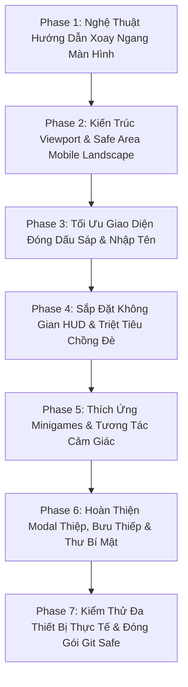

# KẾ HOẠCH TỔNG THỂ: TỐI ƯU HÓA TOÀN DIỆN GIAO DIỆN MOBILE & TABLET (ƯU TIÊN MOBILE LANDSCAPE)

> **Mục tiêu tối thượng**: Tập trung 100% nguồn lực khắc phục triệt để mọi lỗi giao diện trên điện thoại và máy tính bảng (đặc biệt là chế độ xoay ngang - Mobile Landscape). Không can thiệp làm thay đổi hay ảnh hưởng đến giao diện PC vốn đã hoàn thiện.
> **Triết lý trải nghiệm**: Khởi đầu bằng một hiệu ứng hướng dẫn xoay ngang đậm chất Thơ ca Di sản Việt Nam, dẫn dắt người dùng bước vào không gian khu vườn rộng mở theo chiều ngang, mọi tương tác, nút bấm, khuôn đồng, nét chữ đều chuẩn xác, rõ ràng, không đè lấn, không khuất màn hình trên bất kỳ dòng điện thoại nào.

---

## I. NGUYÊN TẮC THIẾT KẾ & BẢO TOÀN KIẾN TRÚC

1. **Bảo Toàn Tuyệt Đối Giao Diện PC (Zero PC Regression)**:
   - Tất cả các tinh chỉnh CSS chỉ áp dụng bên trong các Media Query chuyên biệt dành cho Mobile/Tablet và Landscape:
     - `@media (orientation: landscape) and (max-height: 540px)` (Điện thoại xoay ngang).
     - `@media (orientation: landscape) and (max-height: 850px) and (max-width: 1200px)` (Máy tính bảng xoay ngang).
     - `@media (orientation: portrait) and (max-width: 820px)` (Điện thoại xoay dọc - màn hình hướng dẫn xoay).
   - Tuyệt đối không thay đổi các quy tắc CSS dùng chung cho màn hình máy tính lớn ($\ge 1025\text{px}$ và chiều cao $\ge 600\text{px}$).

2. **Tiêu Chuẩn Công Thái Học & Thao Tác Chạm (Touch Ergonomics & WCAG 2.1)**:
   - **Vùng chạm tối thiểu (Tap Target)**: Mọi nút bấm, hạt sáp, dây đàn, chòm sao đều có diện tích bấm $\ge 44\text{px} \times 44\text{px}$.
   - **Khu vực an toàn (Safe Area Insets)**: Tự động chừa lề an toàn bằng `env(safe-area-inset-left)` và `env(safe-area-inset-right)` để tai thỏ (Notch), Dynamic Island hoặc camera nốt ruồi không bao giờ che khuất văn bản hay nút bấm.
   - **Cỡ chữ hài hòa (Typography Hierarchy)**:
     - Văn bản hướng dẫn & nội dung chính: Tối thiểu $13\text{px} - 15\text{px}$, độ tương phản cao, dễ đọc trên nền giấy Dó.
     - Tiêu đề & huy hiệu: $16\text{px} - 20\text{px}$, không bị xuống dòng vụn vặt làm vỡ bố cục.
     - Triệt tiêu hoàn toàn tình trạng chữ li ti $\le 10\text{px}$ khó đọc hoặc chữ khổng lồ gây tràn màn hình.

3. **Chống Chồng Đè & Chặn Tương Tác (Spatial Harmony & No Overlaps)**:
   - Phân chia lại 4 góc màn hình theo tọa độ rõ ràng trên Mobile Landscape.
   - Các cửa sổ Popup / Modal (Mật mã, Khắc tên dập sáp, Bưu thiếp, Thư bí mật, Cẩm nang) được tái thiết kế theo bố cục ngang 2 cột thông minh (Horizontal Split Layout), tự động cuộn nội dung bên trong khi chiều cao màn hình nhỏ ($\le 380\text{px}$).

---

## II. LỘ TRÌNH 7 GIAI ĐOẠN CHI TIẾT (PHASE 1 ĐẾN PHASE 7)

---

### GIAI ĐOẠN 1: NGHỆ THUẬT HƯỚNG DẪN XOAY NGANG MÀN HÌNH (POETIC LANDSCAPE ORIENTATION)
*File trọng tâm: `index.html`, `css/components.css`, `js/orientation-guard.js`*

1. **Tái Thiết Kế Giao Diện Hướng Dẫn Xoay Dọc (`#rotate-device-overlay`)**:
   - Thay thế khung hình đen thô sơ và chữ tiếng Anh *"Please rotate your phone"* bằng màn hình giấy Dó lụa ấm áp, viền họa tiết hoa sen dát vàng đồng bộ phong cách Di Sản Thơ Ca.
   - Hiệu ứng Animation điện thoại nghiêng 90 độ mềm mại, bao quanh bởi những cánh sen lơ lửng và quầng sáng sương mai.
   - Câu từ giàu chất thơ: *"Để thưởng thức trọn vẹn khu vườn hoa di sản 20/10, bạn vui lòng xoay ngang màn hình nhé ✨"*.
2. **Cơ Chế Kích Hoạt Tự Động & Thân Thiện**:
   - Chỉ xuất hiện trên màn hình điện thoại khi cầm dọc (`orientation: portrait` và `max-width: 820px`).
   - Ngay khi người dùng xoay ngang điện thoại, lớp màn tự động biến mất êm dịu (smooth opacity transition), mở ra toàn cảnh khu vườn.
   - Máy tính bảng cỡ lớn (iPad, Galaxy Tab) hoặc người dùng desktop xoay dọc màn hình lập trình không bị chặn oan.

---

### GIAI ĐOẠN 2: KIẾN TRÚC VIEWPORT & SAFE AREA MOBILE LANDSCAPE (`#wrap`, INSETS & AUTO-SCALE)
*File trọng tâm: `css/layout.css`, `js/main.js`*

1. **Tối Ưu Động Cơ Co Giãn Tỷ Lệ Canvas (`resizeWrap` trong `js/main.js`)**:
   - Xử lý chiều cao hạn chế của điện thoại xoay ngang (chiều cao thực tế thường chỉ từ $340\text{px}$ đến $410\text{px}$, khi có thanh URL bar của Safari/Chrome còn giảm xuống $\sim 300\text{px}$).
   - Tối ưu tỷ lệ scale của `#wrap` (khung chuẩn $1100 \times 680$) để cây hoa tình yêu nở rộ nằm ngay ngắn chính giữa bên phải, tạo không gian thoáng đãng cho tà áo dài và bảng thơ bên trái.
2. **Tích Hợp Safe Area Insets Toàn Diện**:
   - Bổ sung đệm an toàn `padding-left: max(16px, env(safe-area-inset-left))` và `padding-right: max(16px, env(safe-area-inset-right))` cho toàn bộ các thanh dock và modal.
   - Tuyệt đối không để camera Dynamic Island / nốt ruồi hay thanh vuốt Home của iPhone/Android đè lên nút bấm.

---

### GIAI ĐOẠN 3: TỐI ƯU GIAO DIỆN ĐÓNG DẤU SÁP & NHẬP TÊN (STAGE 0 IN LANDSCAPE)
*File trọng tâm: `index.html`, `css/components.css`, `js/wax-seal-ceremony.js`*

1. **Màn Hình Khóa Thời Gian (`#time-lock-modal`)**:
   - Tái cấu trúc thành giao diện ngang 2 cột thanh lịch khi ở chế độ xoay ngang:
     - Cột trái: Biểu tượng ổ khóa cổ dát vàng, tiêu đề cổng thời gian và lời chào cá nhân hóa.
     - Cột phải: Ô nhập mật mã mở sớm, nút mở khóa và đồng hồ đếm ngược.
   - Chiều cao không bao giờ vượt quá $90\text{vh}$, tránh việc người dùng phải cuộn trang để thấy nút bấm.
2. **Bàn Chế Tác Con Dấu Sáp (`#name-modal` & `#atelier-stationery-desk`)**:
   - Ở chế độ xoay ngang màn hình thấp, chuyển đổi từ bố cục dọc dài sang **Bố cục 2 Cột Chế Tác Cân Xứng (Artisan Split Workbench)**:
     - **Cột Trái (Khuôn Chữ & Hạt Sáp)**: Khuôn đồng dập nổi tên bạn + Khay 5 loại hạt sáp di sản + Nút chọn 4 hoa văn triện son (sen, cúc, bướm, trăng) + Nút sao chép link tặng bạn.
     - **Cột Phải (Bếp Nến & Phong Thư)**: Nến thơm ấm áp, que diêm lấy lửa, muỗng đồng đun sáp và khu vực đóng dấu sáp trên phong thư.
   - Thao tác quẹt diêm lấy lửa, khuấy sáp và dập con dấu đồng được định vị chính xác, không bị bàn phím ảo hay viền màn hình che khuất.

---

### GIAI ĐOẠN 4: SẮP ĐẶT KHÔNG GIAN HUD & TRIỆT TIÊU CHỒNG ĐÈ (IN-GARDEN SPATIAL HARMONY)
*File trọng tâm: `css/layout.css`, `css/components.css`, `js/realtime-guide.js`*

1. **Phân Vùng 4 Góc Độc Lập Tránh Va Chạm**:
   - **Góc Trên Bên Trái**: Cụm hướng dẫn thời gian thực (`#realtime-guide-hud`) thu gọn thành biểu tượng ngọn cọ / viên ngọc thanh thoát, bảng thoại hiển thị ngắn gọn, tự động né không che khuất bảng điều khiển.
   - **Góc Trên Bên Phải**: Thanh dock tĩnh lặng (`#top-experiential-dock`) gồm nút Zen Mode và nút Chụp Ảnh Polaroid được căn chỉnh vừa vặn với Safe Area.
   - **Góc Dưới Bên Trái**: Cụm Đàn Harp sinh thái, La Bàn Thiên Văn và Chỉ Số Khí Quyển thu nhỏ nhẹ với tỷ lệ scale $0.85$, bố trí bậc thang không che đè lẫn nhau.
   - **Góc Dưới Bên Phải**: Nút Bưu Thiếp 20/10 và Thư Bí Mật được neo sát góc với hiệu ứng phát sáng sương mai.
2. **Khu Vực Giữa Màn Hình**:
   - Tà Áo Dài Di Sản (`#ao-dai-viet-stage4`) và Bạn Đồng Hành Mascot (`#garden-mascot-companion`) có vị trí đứng tự nhiên bên cạnh gốc cây hoa tình yêu, bóng thoại của Mascot không bao giờ đè lên bảng thơ.

---

### GIAI ĐOẠN 5: THÍCH ỨNG MINIGAMES & TƯƠNG TÁC CẢM GIÁC (GARDEN MINIGAMES IN LANDSCAPE)
*File trọng tâm: `js/garden-minigames.js`, `css/components.css`*

1. **Giai Đoạn 2: Giai Điệu Yêu Thương (Simon Melody Acoustic Game)**:
   - Cung tròn 5 nốt chuông hoa được tính toán lại theo bán kính màn hình ngang (`clamp`), đảm bảo toàn bộ 5 nốt chuông luôn hiển thị trọn vẹn trong tầm với của ngón tay cái 2 bên.
   - Hiệu ứng sóng âm lan tỏa không làm che khuất các phần tử xung quanh.
2. **Giai Đoạn 3: Nối Chòm Sao Bắc Đẩu (Constellation Linker)**:
   - Bán kính nhận diện cử chỉ chạm (`proximityRadius`) được tinh chỉnh tối ưu cho màn hình cảm ứng xoay ngang.
   - Tọa độ 5 ngôi sao thật và 2 ngôi sao phụ được giới hạn nghiêm ngặt trong vùng canvas an toàn, không bao giờ rơi vào góc khuất camera hoặc dưới thanh điều khiển.

---

### GIAI ĐOẠN 6: HOÀN THIỆN MODAL THIỆP, BƯU THIẾP & THƯ BÍ MẬT (POLAROID, POSTCARD & LETTER)
*File trọng tâm: `css/components.css`, `js/secret-letter.js`, `js/boarding-pass-modal.js`, `js/garden-stages.js`*

1. **Hộp Thư Bí Mật & Thẻ Polaroid 3D (`#letter-overlay-modal`)**:
   - Thẻ Polaroid 3D tự động co giãn theo chiều cao viewport ngang ($\le 340\text{px}$), giữ nguyên tỷ lệ thẩm mỹ, không bị méo hình.
   - Bức thư giấy Dó có thanh cuộn mượt mà; cỡ chữ thơ $14\text{px} - 16\text{px}$ rõ ràng, dễ đọc; nút đổi font chữ "Aa" và nút lật thiệp luôn nằm trong tầm tay.
2. **Bưu Thiếp Di Sản Postcard Modal (`#boarding-pass-modal`)**:
   - Cung cấp chế độ cuộn ngang hoặc tỷ lệ xem linh hoạt cho tấm bưu thiếp khổ dọc $1080 \times 1920$.
   - Các nút chức năng *"Tải Ảnh Thiệp Về Máy"*, *"Đổi Lời Chúc"*, *"Đổi Loài Hoa"* được xếp thành hàng ngang tiện lợi dưới chân thiệp.
3. **Modal Khoảnh Khắc Vườn Kỷ Niệm (`#garden-polaroid-modal`)**:
   - Khung xem trước ảnh chụp Polaroid tự động vừa khít chiều cao màn hình ngang, các nút tải ảnh và chia sẻ hiển thị rõ ràng, không bị đẩy ra khỏi màn hình.

---

### GIAI ĐOẠN 7: KIỂM THỬ ĐA THIẾT BỊ THỰC TẾ & ĐÓNG GỐI HOÀN HẢO (TESTING & GIT HARMONY)
*File trọng tâm: Toàn bộ codebase*

1. **Kiểm Thử Giả Lập Môi Trường Đa Thiết Bị (Device Matrix Emulation)**:
   - Điện thoại màn hình nhỏ: iPhone SE (568x320 landscape).
   - Điện thoại phổ thông: iPhone 12/13/14 Pro (844x390 landscape), Samsung Galaxy S20/S21 (800x360 landscape).
   - Điện thoại màn hình dài: iPhone 15 Pro Max (932x430 landscape), Sony Xperia (853x360 landscape).
   - Máy tính bảng: iPad Mini (1024x768), iPad Pro (1366x1024).
   - Đối chứng màn hình PC (1920x1080): Đảm bảo 100% không có bất kỳ sự xáo trộn nào trên PC.
2. **Kiểm Tra Tiêu Chuẩn Kỹ Thuật Tuyệt Đối**:
   - Cú pháp JavaScript: Toàn bộ 19 file `js/*.js` vượt qua kiểm tra `node -c`.
   - Cân bằng CSS: Toàn bộ 3 file CSS cân bằng tuyệt đối dấu ngoặc nhọn `{}`.
   - Hiệu năng 60fps mượt mà, không giật lag.
3. **Quy Trình Git Độc Lập An Toàn**:
   - Fetch remote, giải quyết xung đột nếu có commit mới từ đồng đội, merge sạch sẽ vào nhánh `main` và bàn giao hoàn mỹ.
