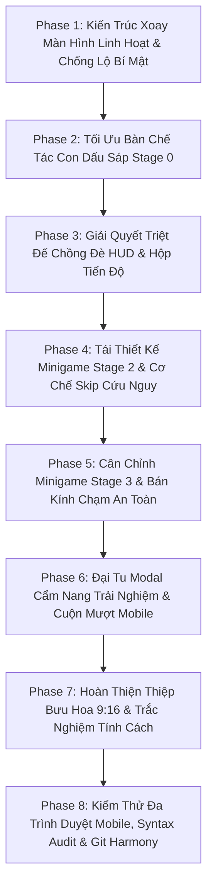

# KẾ HOẠCH TỔNG THỂ: TỐI ƯU HÓA TOÀN DIỆN MOBILE & TABLET (IPHONE 14 SAFARI AUDIT)

> **Mục tiêu tối thượng**: Khắc phục 100% các lỗi giao diện và chặn tương tác được phát hiện từ dữ liệu 9 ảnh chụp kiểm thử thực tế trên iPhone 14 (Safari iOS). Bảo toàn tuyệt đối 100% giao diện PC (Zero PC Regression).
> **Nguyên tắc cốt lõi**:
> 1. Linh hoạt xoay dọc / xoay ngang (Dual-Orientation Flow): Bàn chế tác dập sáp Stage 0, Trắc nghiệm tính cách hoa và Thiệp bưu hoa di sản khuyến khích xoay dọc; Vườn hoa panorama và Minigames xoay ngang.
> 2. Tuyệt đối không làm lộ (Zero Spoiler) bí mật 20/10 trên màn hình nhắc xoay màn hình; phong cách đồ họa giấy Dó ngà, hoa sen dát vàng đồng bộ di sản.
> 3. Cơ chế cứu nguy (Graceful Skip Fallback): Khi người chơi gặp khó khăn (thử quá 5 lần hoặc quá 40 giây) ở Minigame Stage 2 & Stage 3, tự động hiển thị nút bỏ qua thi vị để luôn tiếp tục được hành trình.
> 4. Triệt tiêu triệt để hiện tượng đè lấn HUD và chữ bị cắt khuất không thể cuộn trên mobile landscape.

---

## I. TỔNG QUAN PHÂN TÍCH 9 ẢNH CHỤP THỰC TẾ TRÊN IPHONE 14 SAFARI

| STT | Ảnh thực tế | Vấn đề phát hiện | Nguyên nhân gốc rễ & Giải pháp |
|---|---|---|---|
| 1 | `...9aa8.jpg` | Bàn chế tác dập sáp Stage 0 (`#atelier-stationery-desk`) bị dồn ép, tiêu đề "VÀO KHU VƯỜN" bị che bởi thanh Safari, "BƯỚC 1/7" đè lên chữ, khuôn đồng và khay sáp bị cắt dưới đáy. | Chiều cao Safari xoay ngang quá hẹp (~250-300px). Chuyển Stage 0 sang ưu tiên **Xoay Dọc (Portrait)** để tận dụng chiều cao 844px; đồng thời tối ưu layout 2 cột cuộn mượt nếu dùng ngang. |
| 2 | `...155f.jpg` | Stage 1: Huy hiệu Realtime Guide ("GIAI ĐOẠN 1...") đè lên 1/3 bên trái của hộp tiến độ ("Mầm sinh - Vươn cành"). Thẻ thời tiết đè lên mầm cây. | `.realtime-guide-hud` (left: 16px, max-width 340px) và `#garden-ui` (center, max-width 360px) va chạm ~100px. Thu gọn guide HUD thành ngọc thu nhỏ trên landscape. |
| 3 | `...100c.jpg` | Modal Polaroid Vườn Kỷ Niệm hiển thị khung cảnh trống chưa có cây nở hoa. Nút bấm tương đối ổn nhưng viền trên sát mép Safari. | Tinh chỉnh padding `env(safe-area-inset)` và đảm bảo cây hoa được render chuẩn xác khi chụp ảnh. |
| 4 | `...0d63.jpg` | Modal Cẩm nang (`#experience-guide-modal`): Tiêu đề bị che, nội dung chỉ thấy 1 dòng, nút "Khám Phá Khu Vườn Ngay" đè lên chính giữa che hết chữ, không cuộn được. | `max-height: 86vh` không trừ thanh Safari; header và footer chiếm hết chiều cao khiến `.guide-content` bị bóp nghẹt. Chuyển sang bố cục Flexbox với `dvh`, body cuộn độc lập, footer gắn đáy. |
| 5 | `...3ec1.jpg` | Tab "Mẹo Trải Nghiệm" trong Cẩm nang bị che mất nửa dòng chữ đầu và cuối, nút đóng 'X' bị khuất góc thanh Safari. | Cố định nút 'X' theo safe area, thiết lập padding cho các tab nội dung cuộn trơn tru. |
| 6 | `...154e.jpg` | Stage 2: Hộp hướng dẫn và Realtime Guide đè nhau. Dưới gốc cây xuất hiện cụm nốt "Mộc Cầm" li ti (~20px) dưới thảm cỏ, không thể nhìn rõ hay bấm được. | Chữ hướng dẫn nhắc "giai điệu mộc cầm" khiến người dùng bấm vào dàn đàn Harp li ti ở đáy thay vì chuông Simon. Harp ở mobile landscape bị thu nhỏ quá mức bên trong `#wrap`. |
| 7 | `...3aba.jpg` | Stage 2: Người chơi nhận thông báo "Đến lượt bạn gảy lại từng nốt nhạc", nhưng 4 nốt chuông Simon bị che khuất / quá nhỏ, cụm Mộc Cầm li ti không phản hồi, người chơi bị kẹt vĩnh viễn. | Tọa độ chuông Simon bị rơi vào điểm mù; thiếu nút Bỏ qua (Skip) cứu nguy khi người dùng thử nhiều lần không được. |
| 8 | `...102f.jpg` | Màn hình xoay ngang (`#rotate-device-overlay`) nền đen tuyền thô ráp, có huy hiệu `"KHU VƯỜN DI SẢN 20/10"` và câu chữ làm lộ bí mật 20/10 ngay từ đầu; chỉ ép xoay ngang 1 chiều. | Lộ nội dung bí mật (spoil); thiết kế chưa chuẩn thẩm mỹ Giấy Dó/Hoa Sen; cơ chế cứng nhắc 1 chiều. |
| 9 | `...8be1.jpg` | Stage 2 lúc hoàng hôn: Tình trạng tương tự ảnh 7, các nốt chuông không rõ ràng, tiến độ và HUD đè lấn. | Độc lập không gian giữa HUD điều khiển và vùng thao tác ngón cái của trò chơi âm nhạc. |

---

## II. LỘ TRÌNH TRIỂN KHAI CHI TIẾT (8 GIAI ĐOẠN)

---

### GIAI ĐOẠN 1: KIẾN TRÚC XOAY MÀN HÌNH LINH HOẠT & CHỐNG LỘ BÍ MẬT (DUAL-ORIENTATION & ANTI-SPOILER)
*Mục tiêu*: Người dùng xoay dọc/ngang linh hoạt theo từng phân cảnh trải nghiệm, giao diện hướng dẫn xoay mang đậm phong cách Giấy Dó Thơ Ca, không tiết lộ ngày 20/10.
*File trọng tâm*: `index.html`, `css/components.css`, `js/orientation-guard.js`

1. **Khử Bỏ 100% Chi Tiết Gây Lộ Bí Mật (Zero Spoilers)**:
   - Xóa bỏ huy hiệu `KHU VƯỜN DI SẢN 20/10` trên `#rotate-device-overlay`. Thay bằng huy hiệu thanh nhã: `✦ NÉT ĐẸP KHU VƯỜN ✦`.
   - Biên tập lại câu chữ hướng dẫn xoay:
     - Khi cần xoay ngang: *"Để chiêm ngưỡng toàn cảnh khu vườn ngập tràn hoa lá và những giai điệu êm dịu, bạn vui lòng xoay ngang điện thoại nhé ✨"*.
     - Không nhắc đến ngày kỷ niệm, bảo toàn trọn vẹn cảm xúc bất ngờ khi bức thư cuối cùng mở ra.
2. **Thiết Kế Mỹ Thuật Giấy Dó & Cánh Sen Chao Liệng (Heritage Aesthetics)**:
   - Thay thế nền đen tuyền `#0d090d` bằng nền bán trong suốt lụa ngà giấy Dó (`rgba(250, 247, 240, 0.96)` với sương mờ ngày, hoặc `rgba(24, 30, 48, 0.96)` huyền ảo đêm).
   - Viền thẻ bo tròn uốn lượn, dát vàng đồng `#D4AF37`, biểu tượng điện thoại nghiêng 90 độ mềm mại với hoa sen hé nở trong lòng màn hình.
3. **Cơ Chế Điều Hướng Xoay Linh Hoạt 2 Chiều (Bi-Directional Adaptive Guard)**:
   - Cho phép hệ thống chuyển đổi giữa 2 chế độ:
     - `require-landscape`: Áp dụng cho Vườn hoa chính (Stage 1 - 4), ngắm cây nở hoa và Minigames.
     - `require-portrait`: Khuyến khích áp dụng khi ở Bàn chế tác dập sáp Stage 0 (`#atelier-stationery-desk`), Bưu thiếp câu chuyện 9:16 (`#boarding-pass-modal`), và Bộ câu hỏi trắc nghiệm hoa 3D.
   - Bổ sung nút bấm thi vị *"Tiếp tục ở góc nhìn hiện tại"* (Bypass option) để người dùng khóa xoay màn hình vẫn có thể tiếp tục mà không bị kẹt cứng.

---

### GIAI ĐOẠN 2: TỐI ƯU BÀN CHẾ TÁC CON DẤU SÁP STAGE 0 (PORTRAIT ARTISAN WORKBENCH)
*Mục tiêu*: Bàn chế tác dập sáp hiển thị thoáng đãng, tráng lệ trên điện thoại xoay dọc; đồng thời co giãn hoàn hảo nếu xem xoay ngang.
*File trọng tâm*: `index.html`, `css/components.css`, `js/wax-seal-ceremony.js`

1. **Ưu Tiên Hiển Thị Chiều Dọc Thơ Mộng (Portrait Priority for Stage 0)**:
   - Khi vào Stage 0, hướng dẫn người dùng giữ điện thoại dọc để chiêm ngưỡng bàn làm việc của nghệ nhân:
     - Đỉnh: Khuôn đồng dập nổi tên bạn với hiệu ứng ánh kim.
     - Giữa: Khay đựng 5 hạt sáp di sản & 4 mẫu hoa văn triện son.
     - Dưới: Bếp nến sưởi ấm, que diêm quẹt lửa, muỗng đồng đun sáp nóng chảy và phong thư chờ dập dấu.
   - Thao tác quẹt diêm, khuấy sáp và dập dấu đồng được tối ưu trên toàn bộ diện tích 844px chiều dọc, ngón tay chạm chuẩn xác 100%.
2. **Phương Án Dự Phòng Cho Mobile Landscape (Landscape Fallback)**:
   - Nếu người dùng vẫn chọn xem ngang:
     - Sử dụng đơn vị `dvh` (Dynamic Viewport Height) trừ hao chính xác thanh công cụ Safari.
     - Header thu nhỏ chỉ còn 36px, bỏ các khoảng đệm thừa.
     - 2 cột chia tỉ lệ 48% - 48%, thanh cuộn nội dung mượt mà, triệt tiêu hoàn toàn hiện tượng nút bấm bị đẩy ra ngoài màn hình.

---

### GIAI ĐOẠN 3: GIẢI QUYẾT TRIỆT ĐỂ CHỒNG ĐÈ HUD & HỘP TIẾN ĐỘ (SPATIAL HARMONY IN LANDSCAPE)
*Mục tiêu*: Xóa bỏ 100% tình trạng chồng đè giữa Realtime Guide HUD và hộp tiến độ làm vườn ở trung tâm.
*File trọng tâm*: `css/layout.css`, `css/components.css`, `js/realtime-guide.js`

1. **Tái Cấu Trúc Vị Trí Realtime Guide Trên Mobile Landscape**:
   - Khi màn hình ngang có chiều cao $\le 540\text{px}$:
     - Cụm Realtime Guide (`.realtime-guide-hud`) tự động thu gọn thành một viên ngọc chỉ dẫn nhỏ gọn (`40px \times 40px`) ở góc trái an toàn (`left: max(12px, env(safe-area-inset-left))`).
     - Khi người dùng chạm vào viên ngọc, một bong bóng chỉ dẫn thơ mộng bung ra trong 4 giây rồi tự động thu gọn, không chiếm không gian bầu trời.
2. **Cân Chỉnh Hộp Tiến Độ Làm Vườn (`#garden-ui`)**:
   - Giới hạn chiều rộng tối đa $\le 300\text{px}$, canh giữa màn hình an toàn.
   - Trong suốt các giai đoạn chơi minigame (Stage 2 và Stage 3):
     - Tự động ẩn dòng chữ hướng dẫn phụ (`.instruction`) và gợi ý cử chỉ (`#terrarium-gesture-hint`).
     - Chỉ giữ lại thanh tiến trình 3 nốt mầm thanh mảnh và thông điệp trạng thái cốt lõi.
3. **Thanh Điều Khiển Âm Nhạc & Mascot Tránh Va Chạm**:
   - Mascot nằm ở vị trí góc dưới bên trái an toàn, bong bóng trò chuyện mở lên trên và không đè lấn lên các nốt đàn.

---

### GIAI ĐOẠN 4: TÁI THIẾT KẾ MINIGAME STAGE 2 & CƠ CHẾ SKIP CỨU NGUY (SIMON MELODY & SKIP FALLBACK)
*Mục tiêu*: 4 nốt chuông hoa to rõ, dễ bấm bằng 2 ngón tay cái; phân biệt rõ với đàn mộc cầm; có nút bỏ qua nếu gặp khó khăn.
*File trọng tâm*: `index.html`, `js/garden-minigames.js`, `css/components.css`, `js/garden-stages.js`

1. **Phân Vùng Thao Tác 2 Ngón Tay Cái (Ergonomic Thumb Zones)**:
   - Tái định vị 4 nốt chuông hoa trên mobile landscape:
     - Nốt 1 & Nốt 2: Bố trí ở góc trái an toàn (`left: 14%`, `top: 48%` và `left: 25%`, `top: 68%`).
     - Nốt 3 & Nốt 4: Bố trí ở góc phải an toàn (`right: 25%`, `top: 68%` và `right: 14%`, `top: 48%`).
   - Đường kính nút chuông tăng lên $\ge 64\text{px}$ (vùng chạm $72\text{px}$), có quầng sáng lan tỏa (aura pulse), biểu tượng hoa nở rõ ràng.
2. **Làm Rõ Ngữ Nghĩa Hướng Dẫn**:
   - Thay đổi câu thoại hướng dẫn từ *"gảy lại giai điệu mộc cầm"* thành *"Hãy chạm vào các chuông hoa ngân vang theo giai điệu nhé! 🌸🎵"*.
   - Khắc phục hiểu lầm người chơi bấm vào cụm Mộc Cầm li ti dưới thảm cỏ.
3. **Cơ Chế Bỏ Qua Cứu Nguy (Graceful Skip Fallback Button)**:
   - Thêm biến đếm số lần sai `stage2FailCount` và thời gian bắt đầu `stage2StartTime`.
   - Nếu người chơi bấm sai quá 5 lần HOẶC sau 40 giây chưa hoàn thành:
     - Xuất hiện êm dịu một nút bấm hoa sen: `[Gió Thoảng Hoa Nở · Bỏ Qua Thử Thách 🍃✨]`.
     - Nhấp nút skip sẽ phát âm thanh chuông gió hỷ lạc, tự động hoàn thành Stage 2 và chuyển mầm cây vươn cành sang Stage 3 mà không gây lỗi đứt gãy mạch trải nghiệm.

---

### GIAI ĐOẠN 5: CÂN CHỈNH MINIGAME STAGE 3 & BÁN KÍNH CHẠM AN TOÀN (CONSTELLATION LINKER & SKIP)
*Mục tiêu*: Nối các vì sao trên canvas ngang mượt mà, không rơi vào góc chết, có nút bỏ qua cứu nguy.
*File trọng tâm*: `js/garden-minigames.js`, `css/components.css`

1. **Vùng Phân Bố Sao An Toàn Trên Canvas Ngang**:
   - Thuật toán tạo tọa độ 5 ngôi sao thật và 2 ngôi sao phụ được giới hạn nghiêm ngặt trong vùng đệm an toàn:
     - Tránh xa mép trên (nơi có thanh tiến độ làm vườn).
     - Tránh xa góc trái (nơi có Mascot và thanh nhạc).
     - Tránh xa góc phải (nơi có dock Zen Mode và camera).
   - Bán kính phát hiện ngón tay chạm (`proximityRadius`) nâng lên $48\text{px}$ trên màn hình cảm ứng Safari.
2. **Tích Hợp Nút Bỏ Qua Cho Stage 3**:
   - Nếu nối sai hoặc chưa hoàn thành sau 5 lần thử / 40 giây:
     - Nút cứu nguy xuất hiện: `[Sao Sáng Dẫn Lối · Đi Tiếp ✦✨]`.
     - Tự động vẽ các vệt sao lấp lánh nối thành hình trái tim ngân hà và kích hoạt cây hoa nở rộ (Stage 4).

---

### GIAI ĐOẠN 6: ĐẠI TU MODAL CẨM NANG TRẢI NGHIỆM & CUỘN MƯỢT MOBILE (EXPERIENCE GUIDE SCROLL OVERHAUL)
*Mục tiêu*: Sửa triệt để lỗi Image 4 & 5; modal hiển thị trọn vẹn, chữ to rõ, cuộn mượt mà, nút đóng 'X' dễ bấm trên Safari.
*File trọng tâm*: `css/components.css`, `index.html`

1. **Tái Cấu Trúc Bố Cục Flexbox Khép Kín Theo Chiều Cao Màn Hình**:
   - Áp dụng `height: min(92dvh, 520px)` cho `.guide-dialog` trên mobile landscape.
   - Header (`.guide-header`): Rút gọn đệm lề còn `8px 16px`, ẩn hình cành cây phụ trang trí, giữ tiêu đề ngắn gọn 1 hàng.
   - Nút đóng (`.guide-close-btn`): Neo theo `env(safe-area-inset-right)` với kích thước $38\text{px} \times 38\text{px}$, không bao giờ bị thanh tab Safari che khuất.
2. **Khung Nội Dung Cuộn Độc Lập (`.guide-content`)**:
   - Chiếm toàn bộ không gian còn lại (`flex: 1 1 auto; overflow-y: auto; -webkit-overflow-scrolling: touch;`).
   - Cỡ chữ $13.5\text{px} - 14.5\text{px}$, khoảng cách dòng 1.5, dễ đọc trên nền giấy Dó.
   - Cả 3 tab ("5 Chặng Hành Trình", "Bí Mật Kỳ Diệu", "Mẹo Trải Nghiệm") cuộn trơn tru từ đầu đến cuối.
3. **Thanh Chân Nút Bấm Cố Định Dưới Đáy (`.guide-footer`)**:
   - Đặt ở đáy modal trong dòng chảy flexbox (`flex-shrink: 0`), không bao giờ bay lơ lửng đè lên nội dung bài viết.

---

### GIAI ĐOẠN 7: HOÀN THIỆN THIỆP BƯU HOA 9:16 & TRẮC NGHIỆM TÍNH CÁCH (STORY CARD & QUIZ)
*Mục tiêu*: Tấm bưu thiếp khổ dọc $1080 \times 1920$ và bộ câu hỏi trắc nghiệm hiển thị lộng lẫy chuẩn giao diện Story trên điện thoại dọc.
*File trọng tâm*: `js/boarding-pass-modal.js`, `js/secret-letter.js`, `css/components.css`

1. **Chế Độ Ngắm Bưu Thiếp Khổ Dọc Tối Đa**:
   - Khi mở modal bưu thiếp (`#boarding-pass-modal`), khuyến nghị người dùng xoay dọc điện thoại để tấm thiệp bưu hoa di sản $1080 \times 1920$ phủ kín màn hình như một bức ảnh nghệ thuật.
   - Các nút tác vụ: *"Tải Ảnh Về Máy"*, *"Đổi Lời Chúc"*, *"Đổi Loài Hoa"* được neo cố định dưới đáy với thanh trượt ngang tiện lợi.
2. **Trắc Nghiệm Tính Cách 3D & Thư Bí Mật Khổ Dọc**:
   - Bộ thẻ bài trắc nghiệm hoa lật 3D hiển thị cân đối giữa màn hình, các phương án lựa chọn có diện tích chạm $\ge 48\text{px}$, chữ thơ đọc êm ái, cuộn nhẹ nhàng.

---

### GIAI ĐOẠN 8: KIỂM THỬ ĐA TRÌNH DUYỆT MOBILE, SYNTAX AUDIT & GIT HARMONY
*Mục tiêu*: Toàn bộ mã nguồn đạt chuẩn kỹ thuật tối đa, không có bất kỳ xung đột nào với đồng đội.
*File trọng tâm*: Toàn bộ dự án

1. **Kiểm Tra Kỹ Thuật Độc Lập**:
   - JavaScript: Chạy `node -c js/*.js` trên tất cả 19 file module.
   - CSS: Kiểm tra cân bằng tuyệt đối toàn bộ dấu `{}` trong `base.css`, `layout.css`, `components.css`.
2. **Kiểm Tra Không Hồi Quy PC (Zero PC Regression)**:
   - Đối chứng giao diện desktop $1920 \times 1080$ và $1440 \times 900$: Giữ nguyên 100% bố cục và mỹ quan.
3. **Đồng Bộ Git An Toàn**:
   - `git fetch origin` kiểm tra commit mới từ 2 thành viên còn lại trong team.
   - Giải quyết 100% xung đột (nếu có) một cách êm ái, đảm bảo nhánh `feat/mobile-safari-experience` sạch sẽ, sẵn sàng kết nối.
