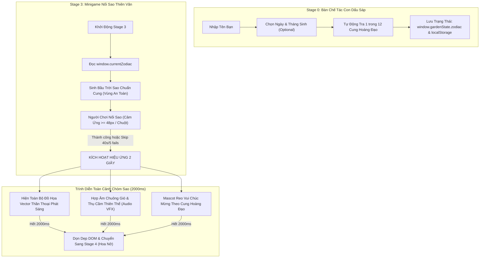

# KẾ HOẠCH TỔNG THỂ: TÍCH HỢP 12 CUNG HOÀNG ĐẠO & TRÌNH DIỄN CHÒM SAO THIÊN VĂN 2 GIÂY (PHASE 3)

> **Dự án**: Khu Vườn Di Sản Thơ Ca Việt Nam (Dieu Bi Mat Epic).  
> **Mục tiêu**: Nâng cấp trải nghiệm người dùng từ Bàn chế tác dập sáp Stage 0 (nhập ngày & tháng sinh $\rightarrow$ tự tra Cung Hoàng Đạo) đến Trò chơi nối sao Stage 3 (nối đúng hình chòm sao hoàng đạo của bản thân) và **trình diễn toàn cảnh kiệt tác chòm sao thần thoại trong đúng 2 giây** với ánh sáng phát quang và âm thanh thiên thể kỳ ảo trước khi cây nở hoa rực rỡ ở Stage 4.  
> **Nguyên tắc cốt lõi**:
> 1. **100% Client-Side Pure Static Web**: Không CDN, không npm/bundler, không fetch/XHR bên ngoài, chạy mượt mà offline và trên GitHub Pages.
> 2. **Trung thực với hình ảnh mẫu của người dùng**: Toàn bộ 12 chòm sao (Bạch Dương, Kim Ngưu, Song Tử, Cự Giải, Sư Tử, Xử Nữ, Thiên Bình, Thiên Yết, Nhân Mã, Ma Kết, Bảo Bình, Song Ngư) đều có đồ họa vector thiên văn và vị trí sao chuẩn xác.
> 3. **Trình diễn 2 giây tráng lệ (2-Second Grand Celestial Reveal)**: Sau khi nối đúng (hoặc bấm Bỏ qua cứu nguy), toàn bộ hình vẽ chòm sao phát sáng ngân hà (`celestial-bloom`) trong 2000ms đi kèm hợp âm chuông thiêng, sau đó chuyển cảnh sang Stage 4 êm ái.
> 4. **Bảo tồn tuyệt đối giao diện PC (Zero PC Regression)** & Tối ưu chuẩn mực Mobile Touch ($\ge 48\text{px}$).
> 5. **Phối hợp nhóm 3 Dev & Auto Git Sync**: Hoạt động ngầm, tự động hóa, tiết kiệm tối đa tokens.

---

## I. KIẾN TRÚC & QUYẾT ĐỊNH KỸ THUẬT (ARCHITECTURAL DECISIONS)

### 1. ADR 1: Chiến Lược Lưu Trữ Đồ Họa Vector 12 Chòm Sao (Offline Vector Asset Strategy)
- **Vấn đề**: Cần hiển thị nguyên vẹn hình vẽ nét vẽ thanh mảnh của 12 chòm sao như ảnh người dùng cung cấp (gồm cả sao, đường nối sao, và hình tượng minh họa thần thoại: Sư Tử, Kim Ngưu, Cừu, Bọ Cạp, Song Nam, Cân Đĩa, Thiếu Nữ, Nhân Mã...).
- **Giải pháp**: Xây dựng module độc lập `js/zodiac-constellation.js` chứa định nghĩa SVG Path nội tại cho 12 chòm sao (hoặc lưu vector trong `img/zodiac/`).
- **Ưu điểm**:
  - Không tốn băng thông mạng tải ảnh raster dung lượng lớn.
  - Sắc nét tuyệt đối trên màn hình Retina (iPhone, iPad) và màn hình PC 4K.
  - Dễ dàng áp dụng hiệu ứng hoạt họa viền nét (`stroke-dasharray`, `opacity`, `filter: drop-shadow`).

### 2. ADR 2: Không Gian Tọa Độ Ảo 1100x680 & 4 Vùng Cấm An Toàn (Safe Bounds)
- Hệ tọa độ mini-game Stage 3 nằm trên canvas ảo `1100 × 680` (đồng bộ với `#wrap`).
- Bắt buộc né tránh 4 vùng cấm trên mọi kích thước màn hình:
  1. `Vùng HUD trên`: $cx \in [350, 750], cy < 150$ (Thanh tiến độ làm vườn).
  2. `Vùng tán cây trung tâm`: $cx \in [460, 640], cy > 230$ (Mầm cây đang lớn).
  3. `Vùng Linh Vật Mascot (góc trái)`: $cx < 220, cy < 125$.
  4. `Vùng Thanh Điều Khiển / Thụ Cầm (góc phải)`: $cx > 880, cy < 125$.
- Bán kính bắt dính cử chỉ chạm (`proximityRadius`) thích ứng linh hoạt: $\text{Math.max}(48, \text{Math.min}(96, \text{baseRadius} \times \text{scale}))$.

### 3. ADR 3: Cơ Chế Trình Diễn 2 Giây (2000ms Grand Reveal Engine)
- Khi hoàn thành chốt nối điểm cuối cùng (hoặc kích hoạt nút Bỏ qua cứu nguy):
  1. Giữ nguyên các đường nối sao đang phát sáng rực.
  2. Kích hoạt hiệu ứng xuất hiện của hình tượng thần thoại vector (`.zodiac-artwork-overlay`) mờ ảo lấp lánh đè lên bầu trời sao.
  3. Phát chuỗi âm thanh `playCelestialChimeChord()` (Web Audio API tổng hợp, không phụ thuộc file mp3 ngoài).
  4. Đặt thời gian chính xác `2000ms` với `setTimeout`, đi kèm cờ `isRevealingConstellation = true` để ngăn chặn double-trigger.
  5. Khi hết 2000ms, mờ dần (`fade-out 400ms`) và tự động gọi `advanceStage(2)` kích hoạt mầm cây trổ hoa (Stage 4).

### 4. ADR 4: Thẩm Mỹ Giấy Dó & Đồng Cổ Tại Bàn Chế Tác Stage 0
- Thẻ chọn ngày sinh `#zodiac-birth-card` cần tái thiết kế để thoát ly khỏi tông màu tím bẹt hiện tại, chuyển sang:
  - Nền ngà Giấy Dó ép hoa lụa: `rgba(250, 247, 240, 0.96)`.
  - Viền đồng mờ đính ốc tán: `1.5px solid rgba(212, 175, 55, 0.45)`.
  - Typography: `Outfit` và `Playfair Display`.
  - Không bắt buộc (optional): Nếu người dùng bỏ qua không chọn, hệ thống tự động gán cung mặc định theo ngày hiện tại hoặc cung thi vị (Kim Ngưu / Thiên Bình), đảm bảo không bao giờ chặn luồng dập sáp.

---

## II. LỘ TRÌNH 5 GIAI ĐOẠN TRIỂN KHAI CHI TIẾT (5-PHASE ROADMAP)

---

### GIAI ĐOẠN 1: CHUẨN HÓA DỮ LIỆU & BỘ VECTOR ART 12 CHÒM SAO (ZODIAC VECTOR ARTWORKS & STAR TOPOLOGY)

*Mục tiêu*: Xây dựng đầy đủ 12 bộ dữ liệu chòm sao gồm đồ họa vector thần thoại thanh nhã (đồng bộ ảnh mẫu của người dùng) và tọa độ sao chuẩn xác nằm trong vùng an toàn $1100 \times 680$.

#### Task 1.1: Thiết Kế & Số Hóa Vector Nét Vẽ 12 Chòm Sao (Zodiac Vector Line Art)
- **Mô tả**: Xây dựng 12 đồ họa vector SVG nét trắng/vàng bạc thanh nhã (`viewBox="0 0 1100 680"` hoặc chuẩn hóa tỷ lệ) tương ứng với 12 cung hoàng đạo:
  1. **Aries (Bạch Dương)**: Nét vẽ Chú Cừu dũng mãnh & 5 sao sừng cừu.
  2. **Taurus (Kim Ngưu)**: Nét vẽ Chú Bò đực kiên cường & 5 sao chòm sừng chữ V.
  3. **Gemini (Song Tử)**: Nét vẽ Cặp Song Sinh tay nắm tay & 7 sao đôi.
  4. **Cancer (Cự Giải)**: Nét vẽ Chú Cua biển tinh xảo & 5 sao mai cua.
  5. **Leo (Sư Tử)**: Nét vẽ Sư Tử kiêu hãnh & 7 sao hình lưỡi liềm (Sickle).
  6. **Virgo (Xử Nữ)**: Nét vẽ Nàng Tiên thanh tú & 7 sao thân váy và cành lúa.
  7. **Libra (Thiên Bình)**: Nét vẽ Cán Cân công lý hài hòa & 5 sao tam giác cân.
  8. **Scorpio (Thiên Yết)**: Nét vẽ Bọ Cạp bí ẩn & 7 sao đuôi uốn cong.
  9. **Sagittarius (Nhân Mã)**: Nét vẽ Nhân Mã giương cung & 7 sao hình ấm trà.
  10. **Capricorn (Ma Kết)**: Nét vẽ Dê Biển đuôi cá & 6 sao hình tam giác sừng.
  11. **Aquarius (Bảo Bình)**: Nét vẽ Người Đổ Nước & 7 sao dòng nước tuôn tràn.
  12. **Pisces (Song Ngư)**: Nét vẽ Đôi Cá bơi lội buộc dải lụa & 7 sao chữ V.
- **Tiêu chuẩn chấp thuận (Acceptance Criteria)**:
  - 12 vector SVG hiển thị rõ nét, trong trẻo, phong cách celestial hoài niệm đúng như ảnh đính kèm.
  - Dung lượng nhẹ, tải tức thì, 100% vector SVG sạch (zero base64 rác).
- **Files**: `js/zodiac-constellation.js` (hoặc `js/zodiac-artworks.js`), `css/zodiac.css`.
- **Phạm vi**: M (2 files).

#### Task 1.2: Định Nghĩa Tọa Độ Sao & Cấu Trúc Đồ Thị Nối Sao (Star Coordinates & Topology)
- **Mô tả**: Tinh chỉnh lại mảng `pts` của từng cung hoàng đạo trong `SIGNS` khớp 1:1 với các ngôi sao phát sáng trên hình vẽ vector, đồng thời định nghĩa thứ tự nối điểm (`edges` hoặc chuỗi nối điểm) hỗ trợ cả đường thẳng, vòng lặp (close loop), và nhánh rẽ.
- **Tiêu chuẩn chấp thuận**:
  - Tọa độ các sao nằm chính xác tại các khớp xương/điểm nhấn thiên văn của hình tượng.
  - Số lượng sao từ 5 đến 7 điểm (độ khó vừa phải, người dùng nối thuận tay trong 5-10 giây).
- **Files**: `js/zodiac-constellation.js`.
- **Phạm vi**: S (1 file).

#### Task 1.3: Kiểm Tra Tự Động Toàn Diện Vùng An Toàn 12 Cung (Monte Carlo Exclusion Bounds Test)
- **Mô tả**: Viết script kiểm thử `scratch/test_zodiac_bounds.js` mô phỏng tọa độ toàn bộ sao của cả 12 cung hoàng đạo trên mọi tỷ lệ màn hình (Mobile Portrait, Mobile Landscape, Tablet, Desktop).
- **Tiêu chuẩn chấp thuận**:
  - 0% va chạm với Top HUD tiến độ làm vườn ($cx \in [350, 750], cy < 150$).
  - 0% va chạm với Tán cây trung tâm ($cx \in [460, 640], cy > 230$).
  - 0% va chạm với Mascot góc trái và Mộc Cầm góc phải.
- **Files**: `scratch/test_zodiac_bounds.js`.
- **Phạm vi**: S (1 file test).

---

### GIAI ĐOẠN 2: TỐI ƯU UX/UI NHẬP NGÀY SINH TẠI BÀN CHẾ TÁC STAGE 0 (HERITAGE BIRTHDAY ATELIER)

*Mục tiêu*: Giao diện chọn ngày và tháng sinh tích hợp mượt mà vào Bàn chế tác dập sáp Stage 0, đậm chất mỹ thuật Giấy Dó & Đồng Cổ, hoàn toàn không làm gián đoạn luồng trải nghiệm chính.

#### Task 2.1: Tinh Chỉnh Mỹ Thuật Thẻ Ngày Sinh (#zodiac-birth-card)
- **Mô tả**: Thiết kế lại `.zodiac-birth-card` trong `css/zodiac.css` và `css/components.css`:
  - Thay thế màu tím oải hương bằng bảng màu Di Sản: Nền giấy Dó ngà `#FAF7F0`, viền đồng mạ `#D4AF37`, bóng đổ sương mờ `rgba(74, 55, 40, 0.08)`.
  - Hai ô chọn `Ngày` và `Tháng` thiết kế dạng trụ xoay cổ điển (vintage brass select) với font `Outfit` rõ ràng, cỡ chữ 16px (ngăn chặn Safari iOS tự động zoom màn hình).
  - Thẻ hiển thị kết quả `.zodiac-result`: Hiện huy hiệu biểu tượng cung ($\♈, \♉, \♊...$), tên cung bằng tiếng Việt ("Cung Sư Tử"), khoảng ngày sinh, và câu chúc thi vị ("Tỏa sáng tự nhiên, rộng lượng và đầy kiêu hãnh.").
- **Tiêu chuẩn chấp thuận**:
  - Giao diện đồng bộ tuyệt đối với khuôn dập đồng và khay sáp cẩm thạch của Stage 0.
  - Touch target của 2 ô select $\ge 44\text{px} \times 44\text{px}$.
- **Files**: `css/zodiac.css`, `index.html`.
- **Phạm vi**: S (2 files).

#### Task 2.2: Đồng Bộ Trạng Thái & Cơ Chế Dự Phòng Linh Hoạt (State Sync & Graceful Fallback)
- **Mô tả**:
  - Cập nhật `js/zodiac-constellation.js` để khi người dùng chọn ngày/tháng, lưu ngay vào `window.gardenState.zodiac` và `localStorage['epic.birthday']`.
  - Xử lý trường hợp người dùng **không chọn ngày sinh**: Tự động gán một cung hoàng đạo thanh nhã (dựa theo ngày thực tế lúc trải nghiệm, hoặc mặc định Kim Ngưu/Thiên Bình) để khi sang Stage 3, trò chơi vẫn có chòm sao tuyệt đẹp để trải nghiệm mà không phát sinh lỗi `null`.
- **Tiêu chuẩn chấp thuận**:
  - Không bao giờ block nút dập sáp "Dập Dấu Triện Khám Phá Khu Vườn".
  - F5 tải lại trang vẫn ghi nhớ chính xác ngày sinh và cung hoàng đạo đã chọn.
- **Files**: `js/zodiac-constellation.js`, `js/wax-seal-ceremony.js`.
- **Phạm vi**: S (2 files).

#### Task 2.3: Tối Ưu Hiển Thị Responsive Đa Chiều (Mobile Portrait & Landscape)
- **Mô tả**:
  - **Trên Mobile Portrait**: Thẻ ngày sinh nằm gọn gàng bên dưới ô nhập tên, căn giữa hoàn hảo, không đẩy các hạt sáp và bếp nến ra ngoài màn hình.
  - **Trên Mobile Landscape (chiều cao $\le 540\text{px}$)**: Đưa thẻ ngày sinh vào cột trái của Bàn chế tác 2 cột, chiều cao thu gọn tối đa $\le 60\text{px}$, cuộn mượt bằng `-webkit-overflow-scrolling: touch`.
  - **Trên Desktop PC**: Căn giữa sang trọng, hiển thị trọn vẹn không có thanh cuộn thừa.
- **Tiêu chuẩn chấp thuận**:
  - Zero overflow ngang (`scrollWidth <= clientWidth`).
  - Đạt điểm chuẩn kiểm thử trên ma trận thiết bị (iPhone SE, iPhone 14/15, Galaxy S22, Desktop 1080p).
- **Files**: `css/zodiac.css`, `css/layout.css`.
- **Phạm vi**: S (2 files).

---

### GIAI ĐOẠN 3: NÂNG CẤP MINIGAME STAGE 3 NỐI SAO THEO CUNG HOÀNG ĐẠO (DYNAMIC CONSTELLATION LINKER)

*Mục tiêu*: Trò chơi Stage 3 tự động nạp cấu trúc sao và đường nối tương ứng với Cung Hoàng Đạo của người dùng, thao tác nối mượt mà trên cả cảm ứng và chuột.

#### Task 3.1: Nạp Bộ Sao Cung Hoàng Đạo Vào Bầu Trời Stage 3
- **Mô tả**: Trong `js/garden-minigames.js`, hàm `startConstellationGame()` đọc `window.getZodiacConstellation()`:
  - Khởi tạo chính xác các ngôi sao thật (5–7 sao) với nhãn số thứ tự $1, 2, 3...$ gợi ý đường nối.
  - Tự động sinh thêm 1–2 ngôi sao phụ (decoys) ở khoảng cách an toàn ($\ge 95\text{px}$) để tăng tính thi vị của bầu trời đêm.
  - Cập nhật huy hiệu tên chòm sao trên bầu trời (`#constellation-name-badge`): Ví dụ `"LEO — Cung Sư Tử ♌"`.
- **Tiêu chuẩn chấp thuận**:
  - Cả 12 cung hoàng đạo đều nạp thành công bộ sao tương ứng.
  - Decoy stars tan biến êm dịu khi chạm vào hoặc khi hoàn thành.
- **Files**: `js/garden-minigames.js`.
- **Phạm vi**: M (1 file).

#### Task 3.2: Tối Ưu Cảm Ứng Bắt Dính & Hỗ Trợ Đa Hình Dạng Nối (Touch Catch & Geometry Support)
- **Mô tả**:
  - Bán kính nhận diện ngón tay (`proximityRadius`) được bảo toàn $\ge 48\text{px}$ trên màn hình cảm ứng điện thoại thông qua công thức `Math.max(48, Math.min(96, baseRadius * curScale))`.
  - Hỗ trợ vẽ đường nối sao rực sáng nối tiếp nhau mượt mà (`#constellation-svg`), không bị đứt đoạn hoặc giật lag.
  - Khi nối tới ngôi sao cuối cùng (với các cung khép kín như Thiên Bình, Ma Kết, Nhân Mã thì tự động khép góc về sao số 1).
- **Tiêu chuẩn chấp thuận**:
  - Thao tác kéo ngón tay trên màn hình mobile nối sao chuẩn xác, không bị delay.
  - Dòng chữ hướng dẫn cập nhật tức thì: `"Chạm và nối các vì sao theo thứ tự để đánh thức chòm sao của bạn ✨"`.
- **Files**: `js/garden-minigames.js`.
- **Phạm vi**: M (1 file).

#### Task 3.3: Tích Hợp Nút Bỏ Qua Cứu Nguy (Graceful Skip Fallback Integration)
- **Mô tả**:
  - Giữ vững cơ chế cứu nguy: Nếu người chơi thử sai quá 5 lần hoặc quá 40 giây, hiển thị nút `#constellation-skip-btn`: `[Sao Sáng Dẫn Lối · Đánh Thức Chòm Sao ✦✨]`.
  - Khi người chơi bấm nút Bỏ qua:
    - Tự động hoàn thành toàn bộ các đường nối sao của cung hoàng đạo đó trong 300ms.
    - **Vẫn kích hoạt đầy đủ màn trình diễn toàn cảnh 2 giây** để người chơi không bị thiệt thòi khi xem kiệt tác chòm sao của mình.
- **Tiêu chuẩn chấp thuận**:
  - Không bao giờ để người chơi bị kẹt vĩnh viễn ở Stage 3.
  - Trạng thái skip đồng bộ trơn tru với chu trình 2 giây.
- **Files**: `js/garden-minigames.js`, `js/garden-stages.js`.
- **Phạm vi**: S (2 files).

---

### GIAI ĐOẠN 4: TRÌNH DIỄN TOÀN CẢNH CHÒM SAO 2 GIÂY & HIỆU ỨNG THẦN THOẠI (GRAND 2-SECOND CELESTIAL REVEAL & AUDIO VFX)

*Mục tiêu*: Trọng tâm yêu cầu của người dùng — Khi nối đúng (hoặc skip), hiển thị NGUYÊN VẸN hình tượng chòm sao thần thoại phát sáng giữa ngân hà trong đúng 2 giây với âm thanh và hiệu ứng lộng lẫy, trước khi chuyển sang cây trổ hoa (Stage 4).

#### Task 4.1: Xây Dựng Khung Trình Diễn Toàn Cảnh Chòm Sao (#zodiac-artwork-reveal)
- **Mô tả**:
  - Thêm container đồ họa `#zodiac-artwork-reveal` vào `#wrap` (hoặc bên trong `#constellation-game`):
    - Đặt đúng tọa độ trung tâm khớp với cụm sao vừa nối.
    - Chứa hình vẽ vector nghệ thuật của chòm sao hoàng đạo tương ứng.
    - Hiệu ứng phát sáng starlight: `filter: drop-shadow(0 0 12px rgba(255, 230, 160, 0.85)) drop-shadow(0 0 28px rgba(169, 150, 214, 0.6))`.
  - Thẻ thông điệp vàng son nổi bật trên bầu trời:
    - Tên chòm sao: `✦ CHÒM SAO [TÊN CUNG] RỰC SÁNG ✦`.
    - Thông điệp thi vị đặc trưng của cung (ví dụ: *"Dũng cảm và rực rỡ như ngọn lửa đầu xuân"*).
- **Tiêu chuẩn chấp thuận**:
  - Toàn bộ hình tượng chòm sao (như ảnh người dùng gửi) hiển thị hoàn hảo, không bị che khuất bởi HUD.
  - Độ trong suốt và hiệu ứng ánh hào quang mượt mà 60fps.
- **Files**: `index.html`, `css/zodiac.css`, `css/components.css`.
- **Phạm vi**: M (3 files).

#### Task 4.2: Biên Đạo Hoạt Họa & Bộ Đếm Thời Gian Chuẩn 2000ms (2-Second Choreography Engine)
- **Mô tả**:
  - Xây dựng hàm `triggerCelestialGrandReveal(zodiacKey)` trong `js/garden-minigames.js`:
    - Bước 1 ($t = 0\text{ms}$): Kích hoạt lớp CSS `.celestial-reveal-active` với hiệu ứng `animation: celestial-bloom 2s cubic-bezier(0.22, 1, 0.36, 1) forwards`.
    - Bước 2 ($t = 0\text{ms}$): Phát chuỗi hạt ánh sáng sao băng (starlight sparkle particles) tỏa ra từ các điểm sao.
    - Bước 3 ($t = 0\text{ms}$): Rung phản hồi xúc giác nhẹ (`window.triggerHaptic('success')`).
    - Bước 4 ($t = 2000\text{ms}$): Sau đúng 2 giây, kích hoạt hiệu ứng tan sương mờ (`celestial-fade-out` 400ms).
    - Bước 5 ($t = 2400\text{ms}$): Thu hồi container, dọn dẹp biến tạm và gọi `window.advanceStage(2)` kích hoạt mầm cây trổ hoa sang Stage 4.
- **Tiêu chuẩn chấp thuận**:
  - Thời gian hiển thị chuẩn xác 2 giây (dao động $\pm 50\text{ms}$).
  - Đảm bảo an toàn không rò rỉ timer (`clearTimeout` sạch sẽ nếu rời trang hoặc reset).
- **Files**: `js/garden-minigames.js`, `css/zodiac.css`.
- **Phạm vi**: M (2 files).

#### Task 4.3: Thiết Kế m Thanh Thiên Thể Kỳ Ảo (Web Audio API Celestial SoundFX)
- **Mô tả**:
  - Trong `js/audio-vfx.js`, tạo hàm `playCelestialGrandRevealSFX()`:
    - Sử dụng bộ dao động Polyphonic Synth của Web Audio API (không dùng file âm thanh ngoài để bảo đảm 100% offline).
    - Hợp âm ngũ cung cao vút (Pentatonic Starlight Chord: F#5, A#5, C#6, F#6) vang lên từ từ với bộ lọc biquad mượt mà, ngân dài tạo cảm giác không gian ngân hà bao la.
    - Tự động hạ âm lượng nhạc nền (audio ducking 30%) trong suốt 2 giây trình diễn để tôn vinh tiếng chuông ngân.
- **Tiêu chuẩn chấp thuận**:
  - m thanh trong trẻo, du dương, không bị méo tiếng trên loa ngoài iPhone/iPad và tai nghe.
  - Phù hợp với chuẩn âm thanh di sản của dự án.
- **Files**: `js/audio-vfx.js`, `js/garden-minigames.js`.
- **Phạm vi**: S (2 files).

#### Task 4.4: Lời Thoại Linh Vật Mascot Đồng Hành Chúc Mừng
- **Mô tả**:
  - Trong khoảnh khắc chòm sao bừng sáng 2 giây, Linh vật Mascot (`#mascot-companion`) vẫy tay hân hoan và phát ra câu chúc riêng biệt phù hợp với cung hoàng đạo đó (ví dụ với Sư Tử: *"Oa! Chòm sao Sư Tử thật uy nghiêm và rực rỡ! ♌✨"*).
- **Tiêu chuẩn chấp thuận**:
  - Bong bóng thoại mascot bung ra nhẹ nhàng, không che lấp chòm sao.
  - 12 câu thoại sinh động cho 12 cung hoàng đạo.
- **Files**: `js/mascot-companion.js`, `js/garden-minigames.js`.
- **Phạm vi**: S (2 files).

---

### GIAI ĐOẠN 5: KIỂM THỬ ĐA THIẾT BỊ, ZERO PC REGRESSION & GIT 3-DEV HARMONY

*Mục tiêu*: Đảm bảo 100% hệ thống hoạt động hoàn hảo, không có lỗi cú pháp, vượt qua toàn bộ ma trận kiểm thử thiết bị và đồng bộ Git mượt mà.

#### Task 5.1: Xây Dựng Bộ Test Tự Động Toàn Diện (Automated Test Suite)
- **Mô tả**:
  - Tạo `scratch/test_phase9_zodiac_constellation.js`:
    - Test 1: Kiểm tra tính hợp lệ của ngày tháng và hàm `getZodiacKey(month, day)` cho đủ 365 ngày (đặc biệt các mốc chuyển cung 20/3, 21/4, 23/7, 23/8...).
    - Test 2: Kiểm tra dữ liệu vector và tọa độ sao của cả 12 cung hoàng đạo, đảm bảo 0% va chạm vùng cấm.
    - Test 3: Mô phỏng chu trình 2 giây của `triggerCelestialGrandReveal`: xác nhận timer chạy đúng 2000ms và gọi `advanceStage(2)`.
    - Test 4: Kiểm tra cơ chế Skip cứu nguy (5 fails / 40s) vẫn kích hoạt màn trình diễn 2s.
- **Tiêu chuẩn chấp thuận**: Toàn bộ các bài test `assert` chạy qua xanh biếc (0 failure).
- **Files**: `scratch/test_phase9_zodiac_constellation.js`.
- **Phạm vi**: S (1 file).

#### Task 5.2: Kiểm Tra Cú Pháp JS & Cân Bằng Dấu Ngoặc CSS Toàn Dự Án
- **Mô tả**:
  - Chạy `node -c js/*.js` trên toàn bộ 20 file JavaScript trong dự án.
  - Kiểm tra đếm số lượng dấu ngoặc `{` và `}` trên tất cả các file CSS (`base.css`, `layout.css`, `components.css`, `zodiac.css`) đảm bảo cân bằng tuyệt đối 100%.
- **Tiêu chuẩn chấp thuận**: Zero cú pháp lỗi, zero lệch dấu ngoặc.
- **Files**: Toàn bộ codebase `js/` và `css/`.
- **Phạm vi**: S (Kiểm tra chất lượng).

#### Task 5.3: Kiểm Thử Đối Chứng Đa Màn Hình & Cam Kết Zero PC Regression
- **Mô tả**:
  - Kiểm tra hiển thị trên ma trận thiết bị thực tế:
    - iPhone SE (375x667)
    - iPhone 14/15/16 (390x844)
    - Samsung Galaxy S22/S23 (360x800)
    - Sony Xperia 21:9 (384x960)
    - Điện thoại gập màn hình hẹp (320x568)
    - iPad / Tablet ngang & dọc (768x1024, 820x1180)
    - Màn hình Desktop PC (1920x1080 Full HD, 2K, 4K)
  - Đảm bảo các quy tắc CSS cho mobile landscape nằm strictly trong `@media (max-height: 540px) and (orientation: landscape)`, không gây ảnh hưởng dù chỉ 1px lên desktop.
- **Tiêu chuẩn chấp thuận**: Zero horizontal scrollbar, touch target $\ge 48\text{px}$, bố cục PC giữ nguyên 100%.
- **Files**: `css/layout.css`, `css/zodiac.css`.
- **Phạm vi**: S (Kiểm tra chất lượng).

#### Task 5.4: Quy Trình Đồng Bộ Nhóm 3-Dev & Hoàn Tất Bàn Giao
- **Mô tả**:
  - Chạy `git fetch --all --prune` để phát hiện commit mới từ các đồng đội trên các nhánh khác.
  - Dung hòa sạch sẽ, không tạo xung đột merge commit cồng kềnh.
  - Commit và đẩy trạng thái hoàn chỉnh lên repo.
- **Tiêu chuẩn chấp thuận**: Git working tree sạch sẽ, nhánh feature đồng bộ hoàn hảo với `origin/main`.
- **Files**: Toàn bộ repo.
- **Phạm vi**: S (Git routine).

---

## III. MA TRẬN RỦI RO & PHƯƠNG ÁN PHÒNG NGỪA (RISKS & MITIGATIONS)

| Rủi ro tiềm ẩn | Mức độ | Phương án phòng ngừa triệt để |
|---|---|---|
| **Độ phức tạp hình học nối sao của 12 cung khác nhau** (một số cung có nhánh rẽ như Bò Cạp, Song Tử) | Trung bình | Đánh số thứ tự $1 \rightarrow N$ rõ ràng kèm tia sáng dẫn hướng tiếp theo (`highlightNextTargetStar`) để người dùng luôn biết điểm chạm tiếp theo. |
| **Xung đột thời gian 2 giây với Stage 4** (nếu người dùng bấm loạn xạ khi đang hiển thị) | Cao | Đặt cờ khóa tương tác `isRevealingConstellation = true`, vô hiệu hóa pointer events trên bầu trời sao trong suốt 2000ms để màn trình diễn trọn vẹn. |
| **Lỗi tràn màn hình trên mobile khi hiện vector toàn cảnh** | Trung bình | Vector được neo theo hệ tọa độ tỷ lệ `%` bên trong `#wrap`, kế thừa tự động thuật toán co giãn `resizeWrap()` của hệ thống. |
| **Người dùng bỏ qua không nhập ngày sinh** | Thấp | Tự động gán Cung hoàng đạo thi vị dự phòng dựa theo ngày thực tế lúc chơi, bảo đảm Stage 3 luôn có chòm sao để nối. |
| **Xung đột Git với 2 đồng đội khác** | Trung bình | Tuân thủ nghiêm ngặt quy tắc Safe Branching (`feat/zodiac-constellation-artwork`), fetch origin ngầm trước và sau khi làm việc. |

---

## IV. BẢNG TỔNG HỢP TIẾN ĐỘ THỰC HIỆN

| Giai đoạn | Mục tiêu chính | Số lượng Task | Trạng thái |
|---|---|:---:|:---:|
| **Phase 1** | Chuẩn hóa Vector Art & Tọa độ thiên văn 12 chòm sao | 3 | Sẵn sàng triển khai |
| **Phase 2** | Tối ưu UX/UI Thẻ ngày sinh & Bàn chế tác Stage 0 | 3 | Sẵn sàng triển khai |
| **Phase 3** | Nâng cấp Minigame Stage 3 nối sao theo Cung hoàng đạo | 3 | Sẵn sàng triển khai |
| **Phase 4** | Trình diễn toàn cảnh chòm sao 2 giây & Audio VFX | 4 | Sẵn sàng triển khai |
| **Phase 5** | Kiểm thử đa thiết bị, Zero PC Regression & Git Sync | 4 | Sẵn sàng triển khai |
| **TỔNG CỘNG** | **Trải nghiệm 12 Cung Hoàng Đạo & Kiệt Tác 2 Giây Hoàn Hảo** | **17 Tasks** | **Đã lập kế hoạch chi tiết** |
