# KẾ HOẠCH TỔNG THỂ: ĐẠI TU TOÀN DIỆN LỖI MOBILE & CHỐNG VA CHẠM GIAO DIỆN ĐA THIẾT BỊ (MOBILE OVERHAUL & ZERO PC REGRESSION)

> **Dự án**: Khu Vườn Di Sản Thơ Ca Việt Nam (Dieu Bi Mat Epic).  
> **Mục tiêu**: Khắc phục triệt để toàn bộ 100% lỗi giao diện và trải nghiệm cảm ứng trên Mobile (dựa trên 7 hình ảnh chụp thực tế trên iPhone 14 và thiết bị Android qua Safari, Cốc Cốc, Chrome), phát hiện và xử lý tận gốc các lỗi tiềm tàng trong mã nguồn.  
> **Cam kết sống còn**:
> 1. **ZERO PC REGRESSION**: Toàn bộ giao diện, hiệu ứng và bố cục trên PC Desktop ($width \ge 1025\text{px}, height \ge 600\text{px}$) được **bảo toàn nguyên vẹn 100%**, không bị ảnh hưởng dù chỉ 1 pixel. Toàn bộ thay đổi CSS được cô lập nghiêm ngặt trong Media Queries:
>    - Mobile Landscape: `@media (max-height: 540px) and (orientation: landscape)` & `@media (max-width: 960px) and (orientation: landscape)`
>    - Mobile Portrait: `@media (max-width: 768px) and (orientation: portrait)` & `@media (max-width: 600px)`
> 2. **100% Pure Client-Side Static Web**: Không CDN, không npm/bundler runtime, không fetch/API ngoại vi, chạy mượt mà offline và trên GitHub Pages.
> 3. **Tương thích hoàn hảo trình duyệt khó tính**: Safari iOS (thanh địa chỉ co giãn, safe-area dynamic island), Cốc Cốc (thanh tab trên/dưới chiếm diện tích), Chrome Mobile.
> 4. **Touch Target Chuẩn WCAG & Apple HIG**: Mọi điểm chạm tương tác đều $\ge 48\text{px}$, không bao giờ bị phần tử khác đè lên nuốt mất sự kiện chạm.

---

## I. BẢNG PHÂN TÍCH NGUYÊN NHÂN GỐC RỄ (ROOT-CAUSE AUDIT TỪ 7 ẢNH THỰC TẾ)

| STT | Ảnh Thực Tế | Hiện Tượng Lỗi | Nguyên Nhân Gốc Rễ Trong Mã Nguồn | Giải Pháp Kỹ Thuật |
| :--- | :--- | :--- | :--- | :--- |
| **1** | `60ed8253-...jpg` | **Ảnh chụp Polaroid bị mất hoàn toàn cây hoa nở** (chỉ có bầu trời, trăng và áo dài). | Trong [js/main.js](file:///c:/Users/kishikuun/Documents/dieu-bi-mat-epic/js/main.js#L148), khi cây nở hoa xong, `moveAnimate()` gán snapshot vào `canvas.parentNode.style.background = "url(" + tree.toDataURL(...) + ")"` và `#canvas` bị `clearRect` liên tục trong `jumpAnimate()`. [js/garden-stages.js](file:///c:/Users/kishikuun/Documents/dieu-bi-mat-epic/js/garden-stages.js#L865) `renderGardenPolaroidToCanvas` chỉ `drawImage(treeCanvas)` nên vẽ canvas rỗng! | Trích xuất ảnh nền cây nở đã lưu trong `window.gardenTreeSnapshotUrl` hoặc `window.gardenTree.toDataURL()`, vẽ đè lên canvas ảnh chụp trước khi vẽ cánh hoa rơi và thiếu nữ Áo Dài. |
| **2** | `35f54e...jpg` | **Stage 2: Nốt nhạc chuông hoa spawn ngay dưới bảng thông báo trắng**, người dùng không bấm được. | Trong [js/garden-minigames.js](file:///c:/Users/kishikuun/Documents/dieu-bi-mat-epic/js/garden-minigames.js#L217), nốt Simon đặt ở tọa độ ảo $t: 34\% - 36\%$. Thẻ `#garden-ui` ở Stage 2 phình to (~130px) do có thêm nút "Nghe lại chuông" và thanh tiến độ, đè trực tiếp lên 2 nốt phía trên với `z-index: 100`. Ngoài ra HUD khí hậu vẫn hiện. | Tái cấu trúc `#garden-ui` Stage 2 siêu tinh gọn; dời tọa độ 4 nốt chuông hoa xuống 2 vùng an toàn 2 bên cánh gà ($t \ge 52\% - 68\%$) đảm bảo cách xa `#garden-ui` tối thiểu 80px; ẩn hoàn toàn `#living-atmosphere-hud`. |
| **3** | `77085d...jpg` | **Stage 1 Landscape: Vệt Nắng & Mây Mưa đè lên bảng chữ `#garden-ui`**; thanh nhạc đè chân Mascot. | Trong [css/components.css](file:///c:/Users/kishikuun/Documents/dieu-bi-mat-epic/css/components.css#L8071), `.living-atmosphere-hud` có `width: min(94vw, 540px)` ở giữa màn hình nên nhãn chữ "Nắng Vàng Ban Mai" tràn vào mép phải `#garden-ui`. Mascot ở `bottom: 48px` đụng chạm thanh nhạc ở `bottom: 8px` (cao 38px). | Tách 2 token khí hậu dạt về 2 biên màn hình (`width: min(96vw, 760px)`) và ẩn nhãn chữ trên mobile landscape; nâng chân Mascot lên `bottom: calc(56px + var(--sab))` triệt tiêu 100% va chạm với thanh nhạc. |
| **4** | `ce720f...jpg` | **Mobile Portrait: Mặt trời/mặt trăng spawn dưới gốc cây; cây và mặt đất lơ lửng giữa trời với đường kẻ đen cắt ngang**. | Trong [css/layout.css](file:///c:/Users/kishikuun/Documents/dieu-bi-mat-epic/css/layout.css#L99), `.sun-dusk` có `top: 60%`, trên màn hình dọc (cao 844px) bị tụt xuống nửa dưới màn hình. Trong [js/love.js](file:///c:/Users/kishikuun/Documents/dieu-bi-mat-epic/js/love.js#L188), `Footer.draw()` vẽ nét đen `rgb(35, 31, 32)` ngang đáy canvas; `#wrap` lại căn giữa màn hình dọc nên đường kẻ đen và bóng cây lơ lửng cắt đôi bầu trời. | Trong media query dọc: neo mặt trời/trăng ở `top: 10% - 16%` (vùng trời cao); đổi nét vẽ `Footer` trên mobile thành màu trong suốt hoặc sương mờ đồng điệu với thảm cỏ; căn chỉnh `#wrap` hòa vào triền đồi tự nhiên. |
| **5** | `125f78...jpg` | **Hộp thoại xoay màn hình bị che khuất nút "Tiếp tục ở góc nhìn hiện tại"** trên trình duyệt có tab (Cốc Cốc/Safari). | Trong [css/components.css](file:///c:/Users/kishikuun/Documents/dieu-bi-mat-epic/css/components.css#L9799), `.rotate-device-card` cao cố định ~426px, trong khi chiều cao khả dụng trên mobile landscape có tab chỉ còn 290px - 340px, khiến phần đáy thẻ bị tràn ra ngoài màn hình và không có thanh cuộn. | Bổ sung `max-height: min(92dvh, 92vh); overflow-y: auto;` cho `.rotate-device-card`; thu gọn hình điện thoại minh họa từ 130px xuống 64px trong landscape để toàn bộ thẻ (gồm nút Bypass) hiển thị trọn vẹn trong $\le 280\text{px}$. |
| **6** | `ed2701...jpg` | **Stage 0 Bàn chế tác dập sáp bị chật chội, dài lê thê trên iPhone Safari dọc**, hàng nút triện bị quấn dòng. | Tất cả 11 thành phần của bàn chế tác xếp dọc đơn lẻ, người dùng Safari phải cuộn màn hình quá dài để tìm bếp nến; 4 nút triện ("Hoa Sen", "Cúc Họa Mi", "Cánh Bướm", "Trăng Non") bị ép vỡ thành 2 dòng so le. | Tối ưu hàng nút hoa văn triện thành 1 hàng 4 cột cân xứng (`flex: 1 1 0`); tinh chỉnh padding gọn gàng, đảm bảo nút xác nhận dập sáp luôn dễ tiếp cận, cuộn mượt mà không kẹt touch. |
| **7** | `ce720f...jpg` & `77085d...jpg` | **Nút La bàn Thiên văn (Orrery Lodestar) đè lên nút Chụp ảnh Polaroid** ở góc trên bên phải. | `.celestial-weather-orrery.orrery-minimized` định vị `right: calc(14px + var(--sar))` trong khi `#top-experiential-dock` định vị `right: calc(58px + var(--sar))` hoặc `64px`. Do độ rộng nút và sai số safe-area, 2 nút bị đè mép lên nhau. | Tăng khoảng cách an toàn: `#top-experiential-dock` chuyển sang `right: calc(68px + var(--sar, 10px))` hoặc hợp nhất nhóm nút góc phải vào một flex dock duy nhất với khoảng cách cố định `8px`. |

---

## II. LỘ TRÌNH TRIỂN KHAI 5 GIAI ĐOẠN CHI TIẾT (5-PHASE ROADMAP)

```mermaid
flowchart TD
    subgraph PHASE_1["Phase 1: Chống Va Chạm Dock Trên & Khí Hậu Tự Nhiên"]
        P1_A["Hợp nhất Dock góc phải: Tránh đè nút Orrery & Camera"]
        P1_B["Tách 2 token Khí hậu dạt 2 biên màn hình Landscape"]
        P1_C["Ẩn triệt để Living Atmosphere HUD ở Stage 2, 3, 4"]
        P1_D["Tăng khoảng cách Mascot với thanh Bottom Audio Dock"]
    end

    subgraph PHASE_2["Phase 2: Tái Thiết Kế Không Gian Stage 2 Chuông Hoa"]
        P2_A["Thu gọn thẻ garden-ui Stage 2"]
        P2_B["Hạ thấp 4 nốt Simon xuống 2 cánh gà: t >= 52%"]
        P2_C["Đảm bảo Touch Target >= 48px và né xa 100% UI trên"]
        P2_D["Kiểm tra nút Bỏ qua cứu nguy & phát lại chuông"]
    end

    subgraph PHASE_3["Phase 3: Đại Tu Giao Diện Dọc (Mặt Trời, Cây & Mặt Đất)"]
        P3_A["Neo Mặt trời/Mặt trăng ở top: 10%-16% trên màn hình dọc"]
        P3_B["Xóa đường kẻ đen Footer love.js lơ lửng giữa trời"]
        P3_C["Căn chỉnh gốc cây kết nối tự nhiên với triền đồi ngọn cỏ"]
    end

    subgraph PHASE_4["Phase 4: Sửa Triệt Để Lỗi Chụp Ảnh Màn Hình & Polaroid"]
        P4_A["Trích xuất ảnh cây nở hoa từ background / snapshot URL"]
        P4_B["Vẽ đè tán cây hoa trái tim vào canvas ảnh chụp Polaroid"]
        P4_C["Đồng bộ ảnh chụp trên cả Safari, Cốc Cốc và Chrome"]
    end

    subgraph PHASE_5["Phase 5: Bọc Khung Giới Hạn Hộp Thoại & Kiểm Thử Toàn Diện"]
        P5_A["Thu gọn Dialog xoay màn hình: Hiển thị 100% nút Bypass"]
        P5_B["Tối ưu Bàn chế tác dập sáp Stage 0 trên Safari dọc"]
        P5_C["Viết test tự động Monte Carlo & Kiểm thử đa thiết bị"]
        P5_D["Git Fetch/Sync, đảm bảo Zero PC Regression & Bàn giao"]
    end

    PHASE_1 --> PHASE_2 --> PHASE_3 --> PHASE_4 --> PHASE_5
```



---

### GIAI ĐOẠN 1: CHỐNG VA CHẠM DOCK TRÊN, KHÍ HẬU TỰ NHIÊN & LINH VẬT (TOP DOCK & ATMOSPHERE HUD ANTI-COLLISION)

*Mục tiêu*: Loại bỏ 100% hiện tượng các nút bấm và nhãn giao diện đè lên nhau ở góc trên và góc dưới màn hình trên điện thoại (cả dọc và ngang).

#### Task 1.1: Tinh Chỉnh Dock Góc Phải Trên (Orrery Lodestar vs. Camera Capture)
- **Mô tả**:
  - Tại [css/components.css](file:///c:/Users/kishikuun/Documents/dieu-bi-mat-epic/css/components.css), rà soát vị trí `#top-experiential-dock` và `.celestial-weather-orrery.orrery-minimized`.
  - Trong media queries mobile (cả landscape cao $\le 540\text{px}$ và portrait rộng $\le 768\text{px}$):
    - Đặt vị trí Orrery Lodestar tại `right: calc(14px + var(--sar, 8px))`.
    - Đặt vị trí `#top-experiential-dock` tại `right: calc(68px + var(--sar, 8px))` với `gap: 6px`.
    - Đảm bảo khoảng cách giữa mép trái của nút Orrery và mép phải của nút Camera luôn $\ge 10\text{px}$ trên mọi độ phân giải.
- **Tiêu chuẩn chấp thuận**: Nút La bàn và Nút Chụp ảnh không bao giờ chạm hoặc đè lên nhau trên iPhone 14 (notch/dynamic island), Android (đục lỗ) và trình duyệt có viền bo tròn.
- **Files**: `css/components.css`.

#### Task 1.2: Tách Rộng Khoảng Cách 2 Token Khí Hậu Trong Landscape & Ẩn Nhãn Chữ Rườm Rà
- **Mô tả**:
  - Trong media query landscape (`@media (max-height: 540px) and (orientation: landscape)`):
    - Mở rộng `.living-atmosphere-hud` từ `width: min(94vw, 540px)` lên `width: calc(100vw - 32px - var(--sal, 0px) - var(--sar, 0px))` với `left: 50%; transform: translateX(-50%);`.
    - Ẩn hoàn toàn `.shifter-pill-label` (chữ "Mây Mưa Sương Sớm" và "Nắng Vàng Ban Mai"), chỉ giữ lại icon đám mây nghệ thuật và vệt nắng vàng với giọt sương mai đung đưa.
    - Token mây đặt cách mép trái an toàn `left: 12px`, token nắng đặt cách mép phải an toàn (dưới cụm dock góc phải).
- **Tiêu chuẩn chấp thuận**: Không còn bất kỳ ký tự nào của khí hậu đè lên bảng thông báo `#garden-ui`.
- **Files**: `css/components.css`.

#### Task 1.3: Ẩn Triệt Để `#living-atmosphere-hud` Ở Stage 2, 3 và 4
- **Mô tả**:
  - Bổ sung quy tắc CSS nghiêm ngặt:
    ```css
    body.stage-2-active #living-atmosphere-hud,
    body.stage-3-active #living-atmosphere-hud,
    body.stage-4-active #living-atmosphere-hud {
      display: none !important;
      opacity: 0 !important;
      pointer-events: none !important;
    }
    ```
  - Cập nhật hàm chuyển cảnh trong [js/garden-stages.js](file:///c:/Users/kishikuun/Documents/dieu-bi-mat-epic/js/garden-stages.js): khi bước vào `stageNum === 2`, gọi ngay `livingHudEl.classList.add('hidden')` và `livingHudEl.style.display = 'none'`.
- **Tiêu chuẩn chấp thuận**: Sang Stage 2 (Chuông Hoa), màn hình hoàn toàn sạch bóng các biểu tượng mây mưa, nhường toàn bộ không gian cho nốt nhạc.
- **Files**: `css/layout.css`, `css/components.css`, `js/garden-stages.js`.

#### Task 1.4: Khử Va Chạm Giữa Linh Vật Mascot & Thanh Nhạc Dưới Cùng
- **Mô tả**:
  - Tại [css/components.css](file:///c:/Users/kishikuun/Documents/dieu-bi-mat-epic/css/components.css#L5514), trong `@media (max-height: 540px) and (orientation: landscape)`:
    - Điều chỉnh vị trí Mascot `.mascot-companion-wrap` từ `bottom: calc(48px + var(--sab))` thành `bottom: calc(56px + var(--sab, 0px))`.
    - Thu nhỏ nhẹ kích thước mascot trong landscape: `width: clamp(58px, 9vw, 76px)`.
- **Tiêu chuẩn chấp thuận**: Chân Mascot cách đỉnh thanh nhạc `.bottom-system-dock` tối thiểu `10px`, bóng thoại không bị thanh nhạc che khuất.
- **Files**: `css/components.css`.

---

### GIAI ĐOẠN 2: TÁI THIẾT KẾ KHÔNG GIAN STAGE 2 CHUÔNG HOA (SIMON MELODY SPATIAL REDESIGN)

*Mục tiêu*: Giải quyết dứt điểm lỗi nốt nhạc sinh ra bên dưới bảng thông báo trắng khiến người dùng không tương tác được.

#### Task 2.1: Tinh Gọn Bảng Hướng Dẫn `#garden-ui` Ở Stage 2
- **Mô tả**:
  - Trong [css/layout.css](file:///c:/Users/kishikuun/Documents/dieu-bi-mat-epic/css/layout.css), áp dụng cấu hình siêu tinh gọn cho `#garden-ui` khi `body.stage-2-active`:
    - Chiều cao tối đa $\le 56\text{px}$ trên landscape, $\le 72\text{px}$ trên portrait.
    - Nút "Nghe lại chuông" (`#simon-replay-btn`) được chuyển thành dạng icon tròn nhỏ $36\text{px} \times 36\text{px}$ hoặc đặt ngang hàng với dòng tiêu đề, không chiếm thêm 1 hàng riêng biệt.
    - Thanh tiến độ 3 bước thu gọn chiều cao $3\text{px}$.
- **Tiêu chuẩn chấp thuận**: Mép dưới của `#garden-ui` không bao giờ vượt quá $68\text{px}$ từ đỉnh màn hình trên điện thoại ngang.
- **Files**: `css/layout.css`, `css/components.css`, `js/garden-minigames.js`.

#### Task 2.2: Tái Định Vị 4 Nốt Chuông Hoa Vào 2 Vùng An Toàn Hai Cánh Gà
- **Mô tả**:
  - Tại [js/garden-minigames.js](file:///c:/Users/kishikuun/Documents/dieu-bi-mat-epic/js/garden-minigames.js#L217):
    - Thay thế bộ tọa độ nốt cũ ($t: 34\% - 36\%$) bằng bộ tọa độ an toàn tuyệt đối:
      ```javascript
      const celestialArcSlots = isMobileLandscape
          ? [
              { l: 15, t: 54 }, // Nốt 0: Trái trên
              { l: 23, t: 72 }, // Nốt 1: Trái dưới (gần ngón cái trái)
              { l: 77, t: 72 }, // Nốt 2: Phải dưới (gần ngón cái phải)
              { l: 85, t: 54 }  // Nốt 3: Phải trên
            ]
          : [
              { l: 18, t: 56 },
              { l: 30, t: 70 },
              { l: 70, t: 70 },
              { l: 82, t: 56 }
            ];
      ```
    - Trong không gian ảo $1100 \times 680$, $t = 54\%$ tương ứng $y = 367\text{px}$, cách xa bảng thông báo trên cùng (kết thúc ở $y \approx 130\text{px}$) hơn $230\text{px}$!
- **Tiêu chuẩn chấp thuận**: Khoảng cách từ đỉnh nốt Simon cao nhất đến đáy `#garden-ui` luôn $\ge 70\text{px}$ thực tế trên màn hình, không bao giờ có sự giao thoa tọa độ dù chỉ 1 pixel.
- **Files**: `js/garden-minigames.js`.

#### Task 2.3: Tối Ưu Phản Hồi Cảm Ứng & Nút Bỏ Qua Cứu Nguy
- **Mô tả**:
  - Đảm bảo mỗi nốt `.simon-node` có vùng chạm thực tế $\ge 52\text{px}$ trên mobile via `::after` hitbox vô hình.
  - Kiểm tra nút Bỏ qua cứu nguy `#simon-skip-btn`: tự động hiển thị sau 5 lần bấm sai hoặc sau 40 giây, bấm vào là vượt qua ngay sang Stage 3, không bị treo game.
- **Tiêu chuẩn chấp thuận**: Thao tác chạm nốt phản hồi âm thanh tức thì $\le 20\text{ms}$, nút skip hoạt động chuẩn xác.
- **Files**: `js/garden-minigames.js`, `css/components.css`.

---

### GIAI ĐOẠN 3: ĐẠI TU BỐ CỤC MÀN HÌNH DỌC - MẶT TRỜI, CÂY & MẶT ĐẤT (PORTRAIT HORIZON OVERHAUL)

*Mục tiêu*: Khắc phục hiện tượng mặt trời/mặt trăng spawn dưới gốc cây và cây nở hoa lơ lửng giữa trời với đường kẻ đen cắt ngang trên màn hình dọc.

#### Task 3.1: Neo Giữ Mặt Trời & Mặt Trăng Luôn Ở Vùng Trời Cao Trên Màn Hình Dọc
- **Mô tả**:
  - Trong [css/layout.css](file:///c:/Users/kishikuun/Documents/dieu-bi-mat-epic/css/layout.css), thêm quy tắc ghi đè nghiêm ngặt trong `@media (max-width: 768px) and (orientation: portrait)`:
    ```css
    @media (max-width: 768px) and (orientation: portrait) {
      .celestial-body.sun,
      .celestial-body.sun-dawn,
      .celestial-body.sun-dusk,
      .celestial-body.moon {
        top: 12% !important;
        right: 12% !important;
        width: 80px !important;
        height: 80px !important;
      }
      .celestial-body.sun-dawn {
        top: 14% !important;
        right: 10% !important;
      }
      .celestial-body.sun-dusk {
        top: 14% !important;
        right: 12% !important;
      }
    }
    ```
- **Tiêu chuẩn chấp thuận**: Trên iPhone 14 và mọi máy dọc, mặt trời hoàng hôn (dusk) và mặt trăng luôn ở 1/4 trên cùng của bầu trời, tuyệt đối không bao giờ tụt xuống ngang thân cây hay rễ cây.
- **Files**: `css/layout.css`.

#### Task 3.2: Khử Đường Kẻ Đen Thô Kệch Của Footer Trong `love.js`
- **Mô tả**:
  - Tại [js/love.js](file:///c:/Users/kishikuun/Documents/dieu-bi-mat-epic/js/love.js#L188), hàm `Footer.draw()` đang vẽ nét đen đậm `rgb(35, 31, 32)` suốt chiều ngang canvas đáy.
  - Trên màn hình dọc, khi canvas co nhỏ và nằm giữa màn hình, nét đen này cắt ngang bầu trời như một vết rách.
  - Cải tiến:
    - Kiểm tra nếu đang ở chế độ mobile portrait hoặc nếu `this.opt.footer.color` được truyền vào:
    - Thay màu nét vẽ đen kịt bằng màu sương cỏ mềm mại `rgba(106, 141, 115, 0.25)` hoặc gradient mờ dần ở 2 đầu, hòa quyện với phong cách tranh thủy mặc và giấy Dó.
- **Tiêu chuẩn chấp thuận**: Không còn đường kẻ đen thô cứng cắt ngang màn hình khi xem ở chế độ dọc.
- **Files**: `js/love.js`, `js/main.js`.

#### Task 3.3: Kết Nối Chân Cây Tự Nhiên Với Chân Màn Hình (Natural Ground Pedestal)
- **Mô tả**:
  - Trong [css/layout.css](file:///c:/Users/kishikuun/Documents/dieu-bi-mat-epic/css/layout.css), bổ sung một dải đồi cỏ phong cảnh nhẹ nhàng ở đáy màn hình dọc hoặc điều chỉnh `top` của `#wrap` trong portrait:
    - Ở Stage 1-3: `#wrap` đặt ở `top: 48%`.
    - Ở Stage 4 (Cây nở hoa): `#wrap` đặt ở `top: 32%` (nhường không gian dưới cho thiếu nữ Áo Dài và thông điệp thơ).
    - Thêm lớp chuyển tiếp mờ (vignette gradient) từ đáy `#wrap` xuống thảm cỏ đáy màn hình để gốc cây trông như đang mọc lên từ lòng đất mẹ.
- **Tiêu chuẩn chấp thuận**: Cây đứng vững chãi, không có cảm giác bị "cắt cụt" hay lơ lửng giữa trời.
- **Files**: `css/layout.css`.

---

### GIAI ĐOẠN 4: SỬA TRIỆT ĐỂ LỖI CHỤP ẢNH MÀN HÌNH POLAROID (INSTANT GARDEN CAPTURE ENGINE)

*Mục tiêu*: Đảm bảo 100% ảnh chụp Polaroid lưu giữ trọn vẹn kiệt tác cây hoa trái tim nở rộ, không bị biến mất như trong ảnh lỗi `60ed8253-...jpg`.

#### Task 4.1: Bắt Snapshot Cây Nở Hoa Lưu Vào Bộ Nhớ Đệm Toàn Cục
- **Mô tả**:
  - Tại [js/main.js](file:///c:/Users/kishikuun/Documents/dieu-bi-mat-epic/js/main.js#L146-L150), trong hàm `moveAnimate()`:
    - Khi cây nở hoa hoàn tất và chuẩn bị chuyển sang `jumpAnimate()`, trích xuất snapshot:
      ```javascript
      window.bloomedTreeSnapshotDataUrl = tree.toDataURL("image/png");
      window.bloomedTreeImage = new Image();
      window.bloomedTreeImage.src = window.bloomedTreeSnapshotDataUrl;
      ```
    - Đồng thời lưu giữ lại cả trạng thái của mầm cây ở Stage 1-3 vào `window.currentGardenSnapshotUrl`.
- **Tiêu chuẩn chấp thuận**: Dữ liệu ảnh cây hoa luôn sẵn sàng trong bộ nhớ RAM, không bị ảnh hưởng bởi vòng lặp `clearRect` của `jumpAnimate()`.
- **Files**: `js/main.js`.

#### Task 4.2: Tái Cấu Trúc Hàm `renderGardenPolaroidToCanvas` Trong `garden-stages.js`
- **Mô tả**:
  - Tại [js/garden-stages.js](file:///c:/Users/kishikuun/Documents/dieu-bi-mat-epic/js/garden-stages.js#L864-L869):
    - Thay thế đoạn code chỉ vẽ `#canvas` rỗng bằng logic kết hợp thông minh:
      1. Nếu `window.bloomedTreeImage` đã tải xong: vẽ trực tiếp hình cây nở rộ tuyệt đẹp vào khung ảnh Polaroid tại tọa độ căn chỉnh chính xác.
      2. Nếu không có `bloomedTreeImage`, thử lấy ảnh từ `canvas.parentNode.style.backgroundImage` (tách chuỗi `url("...")`).
      3. Nếu vẫn không có (ở Stage 1, 2, 3), vẽ trực tiếp `#canvas` mầm cây hiện tại.
    - Đảm bảo tỷ lệ khung hình và độ sắc nét Retina ($1080 \times 1320$).
- **Tiêu chuẩn chấp thuận**: Khi bấm nút 📸 "Lưu Khoảnh Khắc", tấm ảnh Polaroid hiện ra và ảnh tải về luôn có đầy đủ: Bầu trời đúng buổi, Vầng trăng/Mặt trời, Toàn bộ cây hoa trái tim rực rỡ, Thiếu nữ Áo Dài, và Cánh hoa sen rơi.
- **Files**: `js/garden-stages.js`.

#### Task 4.3: Kiểm Tra Tương Thích Tải Ảnh Trên Safari iOS & Cốc Cốc
- **Mô tả**:
  - Đảm bảo cơ chế tải ảnh `downloadPolaroidCard()` hoạt động trên Safari (mở tab mới xem ảnh nếu Safari chặn thẻ `a[download]` ngầm).
  - Thêm nút "Chia sẻ ảnh" (sử dụng `navigator.share` nếu trình duyệt hỗ trợ) để người dùng iPhone có thể lưu trực tiếp vào Photos hoặc gửi qua AirDrop/Zalo.
- **Tiêu chuẩn chấp thuận**: Người dùng trên cả iPhone Safari, Cốc Cốc và Chrome Android đều lưu được ảnh về máy dễ dàng.
- **Files**: `js/garden-stages.js`.

---

### GIAI ĐOẠN 5: BỌC KHUNG GIỚI HẠN HỘP THOẠI & KIỂM THỬ GẮT GAO (OVERLAY BOUNDS & COMPREHENSIVE VERIFICATION)

*Mục tiêu*: Đảm bảo không còn bất kỳ hộp thoại nào bị tràn mép cắt mất nút bấm trên Safari/Cốc Cốc, kiểm thử hồi quy 0 lỗi.

#### Task 5.1: Bọc Khung Giới Hạn & Tối Ưu Landscape Cho Dialog Xoay Màn Hình
- **Mô tả**:
  - Tại [css/components.css](file:///c:/Users/kishikuun/Documents/dieu-bi-mat-epic/css/components.css#L9799-L10058):
    - Bổ sung cấu hình cho `.rotate-device-card`:
      - `max-height: min(92dvh, 92vh, 480px);`
      - `overflow-y: auto;`
      - `-webkit-overflow-scrolling: touch;`
    - Trong media query landscape (`@media (max-height: 540px) and (orientation: landscape)`):
      - Giảm padding từ `28px 22px 24px` xuống `12px 16px 12px`.
      - Thu nhỏ `.rotate-device-stage` từ 130px xuống `64px`, điện thoại từ 88px xuống `46px`.
      - Cỡ chữ `.rotate-poetic-title` giảm xuống `15px`, mô tả xuống `12px`.
      - Nút Bypass `.rotate-bypass-btn` giảm padding xuống `6px 14px`, cỡ chữ `11px`.
      - Toàn bộ chiều cao thẻ chỉ còn $\approx 240\text{px}$, nằm lọt thỏm an toàn trong màn hình $300\text{px}$ của Cốc Cốc có cả 2 thanh bar!
- **Tiêu chuẩn chấp thuận**: Nút "Tiếp tục ở góc nhìn hiện tại" luôn hiển thị mồn một ngay trước mắt người dùng trên mọi điện thoại xoay ngang, không bị cắt mép.
- **Files**: `css/components.css`.

#### Task 5.2: Tối Ưu Bàn Chế Tác Dập Sáp Stage 0 Trên iPhone Safari Portrait
- **Mô tả**:
  - Tại [css/components.css](file:///c:/Users/kishikuun/Documents/dieu-bi-mat-epic/css/components.css):
    - Sắp xếp 4 nút hoa văn triện (`.crest-options-row`) trên màn hình dọc thành 1 hàng 4 cột cân xứng với `display: flex; gap: 6px;`, mỗi nút co giãn đều `flex: 1 1 0; min-width: 0; padding: 6px 2px;`.
    - Tinh chỉnh padding các khối trong Bàn chế tác để người chơi Safari dọc cuộn êm ái, thao tác quẹt diêm, đun sáp và dập triện mượt mà không bị giật lag.
- **Tiêu chuẩn chấp thuận**: Bàn chế tác thanh lịch, 4 hoa văn triện nằm ngay ngắn trên 1 hàng, không quấn dòng xô lệch.
- **Files**: `css/components.css`.

#### Task 5.3: Xây Dựng Bộ Test Tự Động Toàn Diện `scratch/test_mobile_overhaul_regression.js`
- **Mô tả**:
  - Viết kịch bản kiểm thử tự động Node.js kiểm tra:
    1. Kiểm tra va chạm tọa độ (Bounding Box Collision Test) giữa 4 nốt Simon và `#garden-ui` (khoảng cách $\ge 70\text{px}$).
    2. Kiểm tra va chạm giữa Orrery Lodestar và `#top-experiential-dock` (khoảng cách $\ge 10\text{px}$).
    3. Kiểm tra va chạm giữa Mascot và `#bottom-system-dock` (khoảng cách $\ge 10\text{px}$).
    4. Kiểm tra vị trí mặt trời/mặt trăng trong CSS media query portrait (top $\le 16\%$).
    5. Kiểm tra logic gán ảnh `window.bloomedTreeSnapshotDataUrl` trong `main.js` và hàm render ảnh chụp trong `garden-stages.js`.
    6. Kiểm tra cân bằng tuyệt đối dấu ngoặc `{}` trên toàn bộ các file CSS (`base.css`, `layout.css`, `components.css`, `zodiac.css`).
    7. Cú pháp toàn bộ file JS (`node -c js/*.js`).
    8. **Zero PC Regression Test**: Xác nhận 100% CSS của desktop PC không bị biến đổi.
- **Tiêu chuẩn chấp thuận**: Đạt 100% Pass trên tất cả các tiêu chí kiểm thử.
- **Files**: `scratch/test_mobile_overhaul_regression.js`.

#### Task 5.4: Kiểm Tra Thị Giác Thực Tế & Đồng Bộ Git 3-Dev
- **Mô tả**:
  - Chạy `git fetch --all --prune`, đảm bảo không có xung đột với các commit mới của đồng đội.
  - Commit toàn bộ thay đổi với thông điệp rõ ràng trên nhánh `feat/mobile-device-overhaul-fixes`.
  - Giữ làm việc ngầm, tiết kiệm tối đa tokens.
- **Tiêu chuẩn chấp thuận**: Working tree sạch sẽ, sẵn sàng nghiệm thu hoặc merge.

---

## III. CAM KẾT KIỂM THỬ VÀ BẢO TOÀN PC (ZERO PC REGRESSION MATRIX)

| Thiết Bị Kiểm Thử | Độ Phân Giải / Tỷ Lệ | Trình Duyệt | Mục Tiêu Kiểm Thử Nghiêm Ngặt |
| :--- | :--- | :--- | :--- |
| **iPhone 14 / 15 (Portrait)** | $390 \times 844$ (19.5:9) | Safari (có thanh bar trên & dưới) | Mặt trời ở vùng trời cao; Bàn chế tác 4 nút triện 1 hàng; Cây cắm rễ tự nhiên không có vệt đen lơ lửng. |
| **iPhone 14 / 15 (Landscape)** | $844 \times 390$ (Chiếu cao thấp) | Cốc Cốc & Safari | Nốt Simon cách xa bảng thông báo $\ge 70\text{px}$; Hộp thoại xoay hiện đủ 100% nút Bypass; Không đè nút góc phải. |
| **Android Galaxy / Pixel (Portrait)** | $412 \times 915$ (20:9) | Chrome Mobile | Tọa độ mặt trăng/mặt trời chuẩn xác; Bấm chụp ảnh ra đủ cây hoa rực rỡ; Touch target $\ge 48\text{px}$. |
| **Android Galaxy / Xiaomi (Landscape)** | $915 \times 412$ (Landscape hẹp) | Cốc Cốc & Chrome | Token mây và nắng dạt sang 2 biên, không che chữ; Linh vật không đè thanh âm thanh. |
| **Màn Hình Gập (Foldable)** | $320 \times 650$ (Siêu hẹp) | Chrome | Giao diện tự động co giãn, không vỡ layout, không thanh cuộn ngang ngoài ý muốn. |
| **Desktop PC 1080p** | $1920 \times 1080$ | Chrome, Edge, Firefox | **ZERO REGRESSION**: Giữ nguyên 100% bố cục gốc, không bị biến dạng bất kỳ chi tiết nào! |
| **Desktop PC 4K** | $3840 \times 2160$ | Chrome, Edge | **ZERO REGRESSION**: Không bị mờ, không bị lệch tỷ lệ, giữ nguyên tỷ lệ vàng Quiet Luxury Atelier. |
